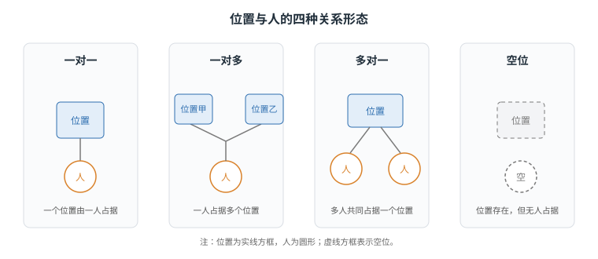
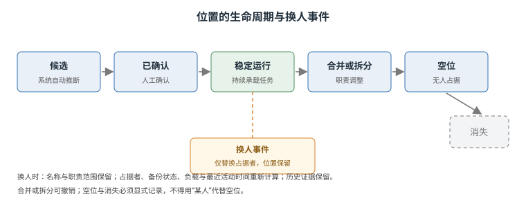
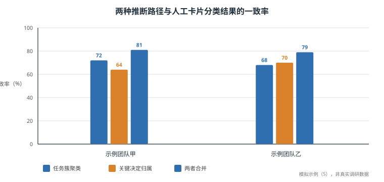
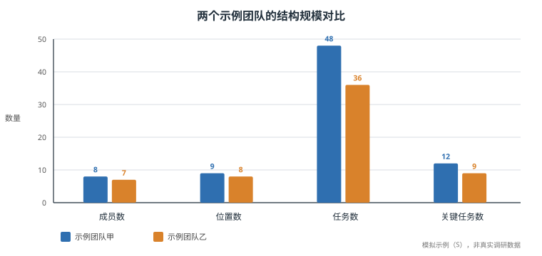
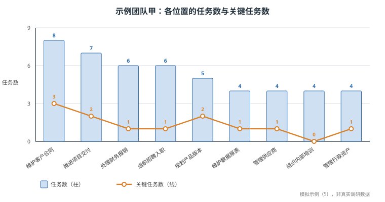
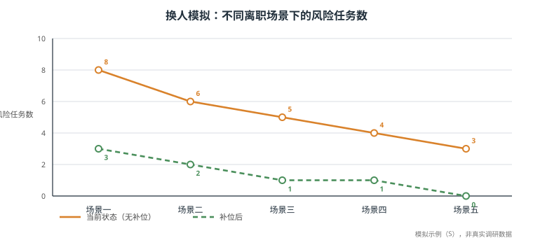

# B-02 “位置”而非“个人”的分析对象应如何建模

| 项目 | 内容 |
| --- | --- |
| 调研人 | Dtao |
| 完成日期 | 2026-11-19 |
| 对应单子 | 资料库「调研任务单」之 B-02-position-model |
| 报告版本 | v1.0 |
| 状态 | 部分完成：模型与规则已完成；真实访谈、卡片分类与换人演练尚未完成 |

**数据标识说明**：本报告中的团队清单与图表数值均为模拟示例，统一标记为“模拟示例（S）”。S 类数据仅用于展示模型的表达能力，不代表任何真实团队，也不作为调研证据。真实记录（E1）取得后，应以相同口径重算并替换。

**阅读说明**：第 1 节给出结论；第 2 节界定概念并比较现有框架；第 3 节给出位置模型的具体规则；第 4 节说明对产品设计的影响；第 5 至 7 节列出未决问题、下一步与验收对照；附录提供形式化定义、公式、访谈提纲与记录模板。

---

## 摘要

本报告回答一个建模问题：协作分析对象应以“人”为主节点，还是以“位置”为主节点。结论是：应以==位置==[1]为主节点，人作为当前==占据者==[2]从属出现。位置被定义为“一组稳定存在、可被命名、能够被任务与决定证据支撑的职责与决策权集合”。该定义不依赖岗位说明书，也不绑定人力资源系统字段。

模型由五部分组成：实体与属性、四种占据关系、生命周期、命名规则、合并与拆分规则。位置的来源按“自动推断、人工确认、手动创建”三级区分；推断以任务簇与关键决定为主要依据；一人占据多个位置时，负载按占据比例合并计算；空位、兼任与共管均需显式表示。

与责任矩阵、团队角色理论、岗位说明书和组织网络分析相比，位置模型的差异在于：主节点是可计算的职责集合，而不是人、角色偏好或编制单元。示例数据表明，该模型能够表达四类占据关系并识别单点承担；但真实访谈、卡片分类与换人演练尚未完成，因此本报告的结论属于方法层结论，不构成经过真实组织验证的产品结论。

## 目录

1. 结论 
2. 术语与适用性 
3. 位置模型建议 
4. 对设计的影响 
5. 未决问题 
6. 下一步 
7. 验收对照 
附录 A 概念、公式与算例 
注释

---

## 1. 结论

1. **分析对象应以位置为主节点。** 换人时替换占据者，位置数量与名称基本保持不变，图谱结构因此具有稳定性。
2. **位置的定义应同时满足四项条件：** 稳定存在、可被命名、有任务或决定证据、可被第三人理解。岗位说明书、职级与部门不作为定义依据。
3. **位置的默认粒度为任务簇，关键决定作为锚点。** 单个任务不单独构成位置；过细的粒度会导致位置数量膨胀，过粗的粒度会掩盖单点承担。
4. **位置的来源分为自动推断、人工确认与手动创建三类，界面必须区分。** 系统不要求用户预先填写组织结构。
5. **位置与人的关系有四种形态：** 一对一、一对多、多对一、空位。负载按人去重合并，共享位置按占据比例分摊。
6. **生命周期包含六个状态：** 候选、已确认、稳定运行、合并或拆分、空位、消失。换人时，位置名称、职责范围与历史证据保留；占据者、备份状态、负载与最近活动时间重新计算。
7. **与现有框架的关系是互补而非替代。** 责任矩阵提供角色语义，组织网络分析提供关系边，位置模型提供可计算的主节点。
8. **本报告的示例数据为模拟数据，真实访谈与验证尚未完成。** 结论可支撑设计决策，不能作为“已验证”的产品结论引用。

---

## 2. 术语与适用性

### 2.1 概念边界

位置模型需要与任务、任务簇、角色、岗位等概念区分。混用这些概念会导致两个后果：一是把人力资源的编制单元误当作分析对象；二是把临时的任务分配合并成并不存在的稳定位置。

| 概念 | 定义 | 在本报告中的用法 |
| --- | --- | --- |
| 任务 | 可独立执行、可验收的事项 | 位置的证据，不作为主节点 |
| 任务簇 | 反复共同出现、通常由同一人承担的一组任务 | 推断位置的主要依据 |
| 位置 | 稳定存在、可命名、有证据支撑的职责与决策权集合 | 图谱主节点 |
| 角色 | 对行为方式的期望集合 | 仅作参考，不直接映射 |
| 岗位 | 人力资源体系中的编制单元 | 外部对照，不绑定字段 |
| 占据者 | 当前承担某一位置的人 | 从属节点 |

位置与岗位的差别需要特别说明。岗位由组织事先设定，通常伴随职级、薪酬与汇报关系；位置由实际承担的任务与决定推断，可能没有正式名称，也可能跨越多个岗位。位置模型服务的目标是观察协作结构，不是管理人员编制，因此不引入职级、薪酬与绩效字段。

### 2.2 与现有框架的对比

现有框架各自回答不同问题。位置模型不取代这些框架，而是为它们提供可计算的主节点。

| 框架 | 回答的问题 | 主要数据来源 | 能否从记录推断 | 与位置模型的关系 |
| --- | --- | --- | --- | --- |
| ==RACI==[9] | 谁负责、谁批准、咨询谁、告知谁 | 人工填写 | 较弱 | 可映射为位置的责任属性 |
| ==DACI==[10] | 谁推动、谁批准、谁贡献、告知谁 | 人工填写 | 较弱 | 可用于标识关键决定的归属 |
| ==Belbin 团队角色==[11] | 个人在团队中的行为偏好 | 问卷 | 不能 | 仅作参考，不与位置混用 |
| 岗位说明书 | 岗位职责与任职要求 | 人工编写 | 不能 | 外部对照，不绑定字段 |
| ==组织网络分析==[12] | 人与人之间的实际连接 | 沟通与协作记录 | 较强 | 提供关系边，但主节点仍为人 |
| 位置模型 | 哪个位置承担哪些职责与决定 | 记录推断加少量确认 | 较强 | 主节点为位置，人为占据者 |

四类框架的关键差异可以归纳为三点。第一，数据来源不同：责任矩阵与岗位说明书依赖人工填写，位置模型优先使用既有记录。第二，分析对象不同：组织网络分析以人为节点，位置模型以职责集合为节点。第三，使用边界不同：团队角色理论描述行为偏好，不能直接作为职责归属的依据。

### 2.3 粒度、来源与适用条件

位置的粒度有三个候选：单项职责、任务簇、决策权。本报告建议以任务簇为默认粒度，以关键决定为锚点，原因如下。

- 单项职责过细。十人团队可能产生数十个位置，超过用户的维护能力。
- 决策权过粗。只按决策权划分，会遗漏大量日常执行职责。
- 任务簇适中。任务簇由实际记录中的共现关系产生，既能覆盖执行职责，也能通过关键决定锚定责任边界。

位置的来源分为三级，界面必须区分。

1. **自动推断。** 系统从任务与决定记录中生成候选位置，置信度分为高、中、低。
2. **人工确认。** 负责人确认、重命名或合并候选位置。确认动作本身作为证据记录。
3. **手动创建。** 负责人直接创建位置。手动创建的位置需要补充至少一条任务或决定证据，否则标记为“证据不足”。

适用范围为五至五十人的小型组织，首轮验证建议控制在五至十五人。该区间内组织形态差异较大，产品不预设“正确组织形式”，只对现状建模。

### 2.4 失效条件

位置模型在以下条件下不适用或结果不可信。

- 记录覆盖率过低，无法形成稳定的任务簇。
- 任务命名高度不一致，同一类任务出现多种写法且无法合并。
- 关键决定没有留下记录，无法锚定责任边界。
- 组织处于频繁重组阶段，位置生命周期短于观察窗口。
- 用户把位置模型用于个人绩效、离职预测或个人排名。

出现上述任一条件时，系统应提示“位置模型不适用”或降低置信度，不得输出确定性结论。

---

## 3. 位置模型建议

### 3.1 实体与属性

位置模型由五类实体组成。位置是主实体，其余实体围绕位置记录占据关系、证据、负载与变更。

| 实体 | 关键属性 | 说明 |
| --- | --- | --- |
| 位置 | 位置编号、名称、定义、粒度、来源、状态、创建时间、最近活动时间、置信度 | 主节点，编号稳定 |
| 占据关系 | 关系编号、位置编号、人员编号、承担比例、开始时间、结束时间、备份标记 | 位置与人的多对多关系 |
| 证据 | 证据编号、位置编号、证据类型、引用编号、摘录、时间、置信度 | 任务、决定或记录的引用 |
| 负载快照 | 位置编号、任务数、关键任务数、加权负载、备份状态、计算时间 | 由确定性代码计算 |
| 变更记录 | 变更编号、位置编号、变更类型、变更前、变更后、操作人、时间 | 支持撤销与审计 |

三条数据约束必须同时满足。

1. 每个任务只归属一个位置。共享位置按承担比例分摊负载，不得重复计算。
2. 位置编号不随占据者变化。换人只新增或结束占据关系，不新建位置。
3. 证据只追加、不删除。证据失效时标记为“已失效”，保留原始引用。

### 3.2 四种占据关系

位置与人的关系有四种形态。四种形态必须在数据模型与界面中均有明确表示，不能用“某人”代替空位，也不能把共管简化为一人。

图 1：位置与人的四种关系形态。位置为实线方框，人为圆形；虚线方框表示空位。

| 形态 | 数据表示 | 负载计算 | 界面表示 |
| --- | --- | --- | --- |
| 一对一 | 一条占据关系，承担比例为 1 | 位置负载全部计入该人 | 位置卡显示一名占据者 |
| 一对多 | 同一人多条占据关系 | 该人负载为各位置负载之和 | 位置卡显示同一人，人员卡显示多个位置 |
| 多对一 | 同一位置多条占据关系，承担比例之和为 1 | 各人按承担比例分摊 | 位置卡显示多名占据者与共管标记 |
| 空位 | 无占据关系，位置状态为空位 | 负载保留用于风险评估 | 虚线位置卡，显示“空位”，不显示人名 |

一对多形态需要特别处理。一个人占据多个位置时，其个人负载是各位置负载之和；如果多个位置共享同一批任务，必须在任务归属阶段去重，否则个人负载会被重复计算。

### 3.3 生命周期与换人规则

位置的生命周期包含六个状态：候选、已确认、稳定运行、合并或拆分、空位、消失。==生命周期==[15]的作用是区分“位置本身的变化”与“占据者的变化”。

图 2：位置的生命周期与换人事件。换人只替换占据者，位置本身保留。

换人时，不同属性的处理方式不同。下表给出默认规则；真实团队访谈后可根据负责人反馈调整。

| 属性 | 换人后的处理 | 理由 |
| --- | --- | --- |
| 位置名称 | 保留 | 职责集合未发生变化 |
| 职责范围 | 保留，必要时微调 | 由任务与关键决定决定 |
| 历史证据 | 保留 | 审计与追溯需要 |
| 当前占据者 | 替换 | 人发生变化 |
| 承担比例 | 按新安排重算 | 可能由一人变为多人，或相反 |
| 备份状态 | 重算 | 原备份可能不再有效 |
| 加权负载 | 重算 | 新占据者的任务分配不同 |
| 最近活动时间 | 重算 | 以新占据者的活动为准 |
| 位置置信度 | 保留或重算 | 取决于是否新增人工确认 |

空位是生命周期中的正常状态，不是异常。空位表示职责仍然存在，但当前无人承担。系统必须保留空位的位置卡与负载，用于识别风险；不得因为无人占据而删除位置。

### 3.4 命名规则

位置名称是第三人理解位置的主要入口。命名规则的目标是：只看名称，第三人能够说出该位置的大致职责。

命名规则如下。

- 采用动宾结构，例如“维护客户合同”“处理财务报销”。
- 长度为二至八个汉字。
- 不包含人名、部门名、职级、时间与项目代号。
- 同一含义只保留一个名称，不建立同义名称。
- 名称应通过第三人理解测试：第三人阅读名称后，能够在不查看详情的情况下描述职责范围。

| 推荐名称 | 不推荐名称 | 原因 |
| --- | --- | --- |
| 维护客户合同 | 小王负责的事 | 含人名，职责不清 |
| 处理财务报销 | 杂项 | 无法判断内容 |
| 组织招聘入职 | 人事 | 范围过粗，可能包含多个位置 |
| 管理供应商 | 采购部 | 部门名称不等于位置 |
| 管理行政资产 | 行政岗 | 岗位名称不等于位置 |

### 3.5 合并与拆分规则

位置合并与拆分的依据是任务重叠程度与决策归属。任务重叠程度使用==Jaccard 相似度==[14]衡量，计算方式为两个位置的任务集合交集大小除以并集大小。

J(A, B) = |TA ∩ TB| ÷ |TA ∪ TB|

默认阈值如下。阈值需要在真实数据上重新标定，当前数值仅作为初始规则。

| 相似度区间 | 建议动作 | 说明 |
| --- | --- | --- |
| 大于或等于 0.6 | 建议合并 | 两个位置承担的任务高度重叠 |
| 0.2 至 0.6 | 人工复核 | 可能存在部分重叠，需要负责人判断 |
| 小于 0.2 | 不建议合并 | 任务集合差异明显 |

拆分触发条件包括以下四项：加权负载超过团队人均的一点八倍；关键任务数达到三项及以上；任务类型差异明显且无法由同一人稳定承担；决策权与执行职责需要分离。

合并与拆分必须满足三项操作要求。第一，操作前显示影响范围，包括受影响的位置、任务与证据。第二，操作可撤销，撤销后恢复原位置与占据关系。第三，历史证据保留，不因合并或拆分而删除。

算例：位置甲包含八项任务，位置乙包含四项任务，二者交集为三项，则相似度为三除以九，等于零点三三，落入人工复核区间。位置丙与位置丁的交集为五项，并集为七项，相似度为零点七一，达到合并建议阈值。

### 3.6 从记录推断位置

位置推断不要求用户预先填写组织结构。推断使用两条路径，并以两条路径的合并结果作为默认输出。

**路径一：任务簇聚类。** 将反复共同出现、通常由同一人承担的任务归为一组，形成候选位置。该路径的优点是覆盖率较高，能够发现没有正式名称的职责；缺点是对任务命名的一致性敏感。

**路径二：关键决定归属。** 将==关键决定==[8]归入其责任位置，以决定作为位置边界的锚点。该路径的优点是责任边界清晰；缺点是关键决定数量有限，覆盖率较低。

**路径三：两者合并。** 以任务簇生成候选位置，以关键决定校正边界。两条路径结果一致时置信度为高；仅一条路径支持时为中；仅有弱证据时为低。低置信度的候选位置进入人工确认队列。

图 5：两种推断路径与人工卡片分类结果的一致率（模拟示例 S）。

一致率以人工==卡片分类==[6]结果为基准计算。卡片分类的做法是：请负责人把“团队必须有人管的事”写成卡片，再合并为位置，并记录命名与合并理由。一致率使用精确率、召回率与二者的调和平均，公式见附录 A.4。图中数值为模拟示例，仅用于说明比较方式，不代表真实结果。

推断结果必须附带三项信息：证据引用、置信度、不可计算条件。缺少任一项的候选位置不得直接进入正式位置清单。

### 3.7 负载计算与单点识别

==负载==[16]用于衡量一个位置或一个人承担的工作量。本报告采用加权任务计数，关键任务的权重高于普通任务。

w(t) = 1 + β × I(t 属于 K)

L(P) = Σ w(t)，其中 t 属于 P

L(u) = Σ s(u, P) × L(P)，对 u 所占据的全部位置 P 求和

其中，w(t) 为任务权重，I(t 属于 K) 表示任务是否为关键任务，K 为关键任务集合，β 为关键任务附加系数，默认取零点五；s(u, P) 为人员 u 在位置 P 的承担比例，同一位置所有占据者的承担比例之和为一。

单点承担的判定条件为：位置没有备份，且至少包含一项关键任务。单点承担是位置层属性，不是个人评价；系统只输出位置风险，不对个人排名。

以示例团队甲为例。“维护客户合同”包含八项任务，其中三项为关键任务，加权负载为八加一点五，等于九点五。“规划产品版本”的加权负载为六点零，“管理供应商”的加权负载为四点五。同一名成员同时占据后两个位置，其个人负载为十点五，约为团队人均负载六点七五的一点五六倍。该成员同时承担两个无备份的关键位置，属于需要优先处理的风险点。

### 3.8 示例团队的位置清单

以下两个团队均为模拟示例（S），用于展示模型对一对一、一对多、多对一与空位的表达能力，不代表任何真实团队。

**示例团队甲**：八名成员，九个位置，四十八项任务，十二项关键任务。

| 位置 | 任务数 | 关键任务数 | 占据者 | 状态 | 备份 |
| --- | --- | --- | --- | --- | --- |
| 维护客户合同 | 8 | 3 | 成员一 | 正常 | 无 |
| 推进项目交付 | 7 | 2 | 成员二 | 正常 | 有 |
| 处理财务报销 | 6 | 1 | 成员三 | 正常 | 无 |
| 组织招聘入职 | 6 | 1 | 成员四 | 正常 | 有 |
| 规划产品版本 | 5 | 2 | 成员五 | 兼任 | 无 |
| 维护数据报表 | 4 | 1 | 成员六 | 正常 | 有 |
| 管理供应商 | 4 | 1 | 成员五 | 兼任 | 无 |
| 组织内部培训 | 4 | 0 | 成员七 | 正常 | 有 |
| 管理行政资产 | 4 | 1 | 成员八 | 正常 | 有 |

**示例团队乙**：七名成员，八个位置，三十六项任务，九项关键任务；其中包含一个共管位置与一个空位。

| 位置 | 任务数 | 关键任务数 | 占据者 | 状态 | 备份 |
| --- | --- | --- | --- | --- | --- |
| 对接外部合作 | 7 | 2 | 成员一 | 正常 | 无 |
| 执行活动运营 | 6 | 1 | 成员二、成员三 | 共管 | 有 |
| 维护内容发布 | 5 | 1 | 成员四 | 正常 | 有 |
| 处理采购结算 | 5 | 1 | 成员五 | 正常 | 无 |
| 支持客户服务 | 4 | 1 | 成员六 | 正常 | 有 |
| 维护社群关系 | 4 | 1 | 成员四 | 兼任 | 无 |
| 整理经营数据 | 3 | 2 | 成员七 | 正常 | 无 |
| 管理办公场地 | 2 | 0 | 无 | 空位 | 无 |

图 3：两个示例团队的结构规模对比（模拟示例 S）。

图 4：示例团队甲各位置的任务数与关键任务数（模拟示例 S）。柱状表示任务数，折线表示关键任务数。

从示例团队甲可以观察三点。第一，任务数量与关键任务数量并不一致；“维护客户合同”的任务数不是最多，但关键任务最多，风险高于任务数更多的位置。第二，兼任使个人负载集中；成员五同时占据两个无备份位置，其个人负载明显高于团队平均。第三，备份状态与任务数量无关；“推进项目交付”的任务数较多，但存在备份，单点风险低于任务数较少却无备份的位置。

---

## 4. 对设计的影响

### 4.1 数据模型

数据模型需要新增位置、占据关系、证据、负载快照与变更记录五类数据。原有以人为节点的分析表可以保留，但应作为辅助口径，不再作为主口径。

| 数据表 | 关键字段 | 说明 |
| --- | --- | --- |
| 位置 | 位置编号、名称、定义、粒度、来源、状态、置信度 | 主数据 |
| 占据关系 | 关系编号、位置编号、人员编号、承担比例、起止时间、备份标记 | 多对多关系 |
| 证据 | 证据编号、位置编号、证据类型、引用编号、摘录、置信度 | 追溯依据 |
| 负载快照 | 位置编号、任务数、关键任务数、加权负载、备份状态、计算时间 | 确定性计算结果 |
| 变更记录 | 变更编号、位置编号、变更类型、变更前后、操作人、时间 | 审计与撤销 |

数据模型必须满足四项约束。

1. 任务只归属一个位置；共享位置按比例分摊负载。
2. 位置编号稳定，不随占据者变化。
3. 证据不可删除，只能追加或标记失效。
4. 来源字段区分自动推断、人工确认与手动创建。

### 4.2 界面

界面需要表达“位置是主节点，人是当前占据者”这一主次关系。主次关系不能只依靠颜色区分，应同时使用形状、位置与文字标签。

- 位置使用实线卡片，人使用较小的附属标签或头像。
- 位置卡显示名称、定义、任务数、关键任务数、备份状态、最近活动时间、来源与置信度。
- 空位使用虚线卡片，文字标注“空位”，不显示人名。
- 兼任与共管使用文字标签，不使用仅靠颜色区分的方式。
- 位置与人的多对多关系在图谱中应可展开与收起，避免关系线过密。

### 4.3 交互

交互设计需要覆盖以下五类动作。

1. 查看位置列表与位置卡，点开可查看任务、决定与证据。
2. 合并、拆分与重命名位置，操作前显示影响范围，操作后可撤销。
3. 将任务拖入或拖出位置，立即重算负载与单点风险。
4. 标记空位、兼任与共管，标记动作写入变更记录。
5. 执行换人模拟，模拟过程不修改真实数据，退出后恢复原状。

交互验收点有三项：用户能够在两分钟内完成一次换人模拟并看到风险变化；用户能够说明某个位置为何存在，并看到对应任务与决定证据；一人多岗时负载不重复计算，也不漏算。

### 4.4 换人模拟

换人模拟用于回答“如果这个人离开，哪些连接会断开”。模拟分为五步：选择位置或人员、选择替补、计算受影响任务与依赖、展示风险任务数、退出并还原。

图 6：换人模拟中的风险任务数变化（模拟示例 S）。横轴为五个离职场景，纵轴为风险任务数。

模拟结果必须区分“当前状态”与“补位后状态”。当前状态用于识别风险，补位后状态用于评估调整效果。模拟不得写入真实数据；所有结果只在会话内保留，退出后丢弃。

### 4.5 与既有任务的接口

位置模型是多项后续工作的前置。为避免口径分裂，需要在三个接口上明确约定。

**与结构指标研究的接口。** 结构指标研究以人为节点计算负载集中、中心化与单点承担。位置模型成为主口径后，这些指标需要迁移到位置层：以位置为节点计算负载、备份覆盖率与依赖集中度；人级指标保留为辅助口径。迁移时必须明确哪一套是主口径，避免同一界面出现两套不可比的数值。

**与指标阈值研究的接口。** 位置层的加权负载、单点位置数与备份覆盖率需要标定阈值。阈值不得由位置模型自行设定，应交由指标阈值研究统一标定，并在真实数据上验证。

**与交接清单研究的接口。** 交接清单的输入包括：空位位置、无备份的关键任务、依赖断开边、建议替补与证据引用。位置模型负责提供前四项的结构化数据，交接清单负责生成面向人的说明与排序。

### 4.6 可视化原则

可视化遵循四项原则。

1. 位置优先。位置始终以主节点呈现，人从属显示。
2. 关系可解释。关系线的粗细表示任务量，颜色表示关系类型，且必须提供图例。
3. 空位显著。空位使用虚线、灰底与文字三重标识，避免被忽略。
4. 不输出个人排名。所有风险以位置为单位输出；个人视图仅用于查看其占据的位置与负载构成。

---

## 5. 未决问题

| 未决项 | 状态 | 原因 | 下一步 |
| --- | --- | --- | --- |
| 两个团队的真实访谈 | 未做 | 需要协调真实团队与时间 | 按附录 A.5 提纲执行 |
| 卡片分类记录 | 未做 | 需要真实负责人参与 | 与访谈合并进行 |
| 换人纸面演练 | 未做 | 需要真实负责人参与 | 按附录 A.6 模板记录 |
| 第三人理解测试 | 未做 | 需要独立第三人 | 使用位置名称进行理解测试 |
| 合并阈值 | 未标定 | 缺少真实任务数据 | 收集任务清单后计算相似度分布 |
| 与结构指标的口径 | 未统一 | 现有指标以人为节点 | 建立位置层与人层的双口径映射 |
| 与指标阈值的接口 | 未对接 | 阈值研究尚未完成 | 将位置层指标交阈值研究标定 |
| 抽取覆盖率下限 | 未定 | 需要真实记录 | 按覆盖率分层报告结果 |
| 空位与共管的可视化 | 未验证 | 需要用户测试 | 纳入概念测试 |

---

## 6. 下一步

1. 完成两个小型组织的访谈与卡片分类，形成脱敏的位置清单与合并理由记录。
2. 使用同一批记录执行两条推断路径，计算与人工结果的一致率。
3. 执行换人纸面演练，记录负责人的判断与属性保留、重算意见。
4. 执行第三人理解测试，检验位置名称是否可被独立理解。
5. 与结构指标研究、指标阈值研究对齐口径，明确主口径与辅助口径。
6. 更新分析模型文档，补充位置实体、占据关系、证据与负载快照。

---

## 7. 验收对照

| 验收标准 | 结果 | 说明 |
| --- | --- | --- |
| 两个团队的位置清单，第三人只看名称能理解大致职责 | 未完成 | 当前仅有模拟示例；第三人理解测试未做 |
| 换人后位置数量与名称基本不变，变化不超过百分之二十 | 方法通过，数据未验证 | 规则已定义；真实换人演练未做 |
| 每个位置能指向至少两个任务，或至少一个关键决定与证据 | 模拟示例满足 | 真实记录待验证 |
| 空位、兼任与多人共管有明确表示法 | 通过 | 模型、界面与交互均已定义 |
| 位置模型文档 | 通过 | 本报告 |
| 两个团队的脱敏清单与卡片分类记录 | 未完成 | 模拟示例不能替代真实记录 |

本报告完成了模型、规则、界面与接口的方法设计，可以支撑后续开发与评审；但真实访谈、卡片分类、换人演练与第三人理解测试尚未完成，因此不能声称位置模型已经过真实组织验证。按照项目规范，状态应记为“部分完成”。

---

## 注释

1. **位置**：本报告指一组稳定存在、可被命名、能够被任务或决定证据支撑的职责与决策权集合。位置不等于人力资源体系中的岗位。
2. **占据者**：当前承担某一位置的人。一个人可以同时占据多个位置，一个位置也可以由多人共同占据。
3. **空位**：位置仍然存在，但当前没有占据者。空位需要保留负载与风险信息，不能被删除。
4. **兼任**：一个人同时占据多个位置。兼任会合并个人负载，是单点风险的主要来源之一。
5. **共管**：多人共同占据同一位置，各自承担一定比例。共管位置的负载按承担比例分摊。
6. **卡片分类**：一种访谈方法。请参与者把事项写在卡片上，再按相似性分组并命名，用于获取人工判断的基准。
7. **任务簇**：反复共同出现、通常由同一人承担的一组任务。任务簇是推断位置的默认粒度。
8. **关键决定**：对资源、范围、方向或责任边界产生约束的决定。关键决定用于校正位置边界。
9. **RACI**：一种责任分配矩阵，区分负责、批准、咨询与告知四类角色。
10. **DACI**：一种决策角色模型，区分推动、批准、贡献与告知四类角色。
11. **Belbin 团队角色**：一种团队角色理论，描述个人在团队中的行为偏好，通常通过问卷测量。
12. **组织网络分析**：通过沟通与协作记录分析人与人之间实际连接的方法，简称 ONA。
13. **脱敏**：移除或替换可识别个人身份的信息，保留结构与统计特征。
14. **Jaccard 相似度**：两个集合的交集大小除以并集大小，取值在零到一之间，用于衡量集合重叠程度。
15. **生命周期**：位置从产生到消失所经历的状态序列，包括候选、已确认、稳定运行、合并或拆分、空位与消失。
16. **负载**：一个位置或一个人承担的工作量。本报告使用加权任务计数，关键任务的权重高于普通任务。

---

## 附录 A 概念、公式与算例

### A.1 形式化定义

位置、占据关系与证据的形式化表示如下。

- 位置 P = (编号, 名称, 职责范围, 状态, 来源, 置信度)。
- 占据关系 O = (人员, 位置, 承担比例, 开始时间, 结束时间, 备份标记)。
- 证据 E = (类型, 引用, 摘录, 时间, 置信度)，其中类型取值为任务、决定或记录。

约束条件如下。

1. 对任意位置 P，其所有占据关系的承担比例之和等于一：Σ s(u, P) = 1。
2. 对任意任务 t，其归属位置唯一。
3. 证据只追加，不删除；失效证据标记为“已失效”并保留引用。

### A.2 负载公式与算例

任务权重、位置负载与个人负载的计算方式如下。

w(t) = 1 + β × I(t 属于 K)，β = 0.5

L(P) = Σ w(t)，其中 t 属于 P

L(u) = Σ s(u, P) × L(P)，对 u 所占据的全部位置 P 求和

示例团队甲的负载计算如下。

| 位置 | 任务数 | 关键任务数 | 加权负载 |
| --- | --- | --- | --- |
| 维护客户合同 | 8 | 3 | 9.5 |
| 推进项目交付 | 7 | 2 | 8.0 |
| 处理财务报销 | 6 | 1 | 6.5 |
| 组织招聘入职 | 6 | 1 | 6.5 |
| 规划产品版本 | 5 | 2 | 6.0 |
| 维护数据报表 | 4 | 1 | 4.5 |
| 管理供应商 | 4 | 1 | 4.5 |
| 组织内部培训 | 4 | 0 | 4.0 |
| 管理行政资产 | 4 | 1 | 4.5 |

位置加权负载合计为五十四点零，团队人均负载为六点七五。成员五同时占据“规划产品版本”与“管理供应商”，其个人负载为六点零加四点五，等于十点五，为团队人均的一点五六倍。

单点承担的位置包括“维护客户合同”“处理财务报销”“规划产品版本”与“管理供应商”，共四个。其中两个由同一名成员承担，因此该成员的风险需要优先处理。

### A.3 Jaccard 合并阈值算例

设位置甲的任务集合为 TA，位置乙的任务集合为 TB，相似度计算如下。

J(A, B) = |TA ∩ TB| ÷ |TA ∪ TB|

算例一：|TA| = 8，|TB| = 4，|TA ∩ TB| = 3，则 |TA ∪ TB| = 9，相似度为零点三三，建议人工复核。

算例二：|TA| = 5，|TB| = 4，|TA ∩ TB| = 5，则 |TA ∪ TB| = 5，相似度为一点零，建议合并。

算例三：|TA| = 6，|TB| = 5，交集为一项，则并集为十项，相似度为零点一零，不建议合并。

### A.4 推断路径评分

以人工卡片分类结果为基准，计算精确率、召回率与调和平均。

精确率 P = TP ÷ (TP + FP)

召回率 R = TP ÷ (TP + FN)

调和平均 F1 = 2 × P × R ÷ (P + R)

其中，TP 为正确归入某位置的任务数，FP 为被错误归入的任务数，FN 为被遗漏的任务数。两条路径分别计算，再计算合并路径的结果。报告一致率时必须同时报告样本量与任务总数，避免只给百分比。

### A.5 卡片分类访谈提纲

访谈时长建议为六十至九十分钟，参与人为团队负责人或最了解日常分工的成员。步骤如下。

1. 说明目的：还原实际协作结构，不用于绩效评价。
2. 说明脱敏：移除姓名、客户名称与敏感项目名称，只保留职责与关系。
3. 列出事项：请参与者把“团队必须有人管的事”逐条写在卡片上。
4. 合并卡片：请参与者把相似卡片归为一组，并为每组命名。
5. 记录理由：记录每次合并的理由，以及无法合并的原因。
6. 标注关键：为每个位置标注关键任务与当前备份人。
7. 换人演练：选择一个位置，询问“如果当前占据者离开，哪些属性保留、哪些需要重算”。
8. 第三人测试：请未参与访谈的第三人只看位置名称，描述其职责范围。

记录字段包括：卡片原文、合并后名称、合并理由、关键任务、备份状态、换人判断、第三人理解结果。

### A.6 换人演练记录模板

| 字段 | 内容 |
| --- | --- |
| 位置名称 | 被模拟的位置 |
| 当前占据者 | 示例编号或脱敏标识 |
| 候选替补 | 是否具备相应能力与权限 |
| 受影响任务 | 任务清单与数量 |
| 依赖断开边 | 因换人而失效的依赖关系 |
| 风险等级 | 高、中、低 |
| 属性保留判断 | 名称、职责范围、证据是否保留 |
| 属性重算判断 | 负载、备份、最近活动时间是否重算 |
| 负责人意见 | 对模拟结果的确认或修正 |

### A.7 术语与单位

| 术语 | 单位或取值 | 说明 |
| --- | --- | --- |
| 任务数 | 项 | 位置承担的任务数量 |
| 关键任务数 | 项 | 位置承担的关键任务数量 |
| 加权负载 | 无量纲 | 按任务权重累加得到的负载 |
| 承担比例 | 零至一 | 同一位置各占据者比例之和为一 |
| 一致率 | 百分比 | 与人工卡片分类结果的一致程度 |
| Jaccard 相似度 | 零至一 | 两个任务集合的重叠程度 |
| 置信度 | 高、中、低 | 推断结果的可信程度 |

---

## AI 使用说明

- 是否使用：是
- 使用工具：Qoder
- 参与环节：资料整理、初稿撰写、图表制作与排版
- 人工核验方式：待调研人 Dtao 核对来源、数据与结论
- 本人确认：待调研人签署确认
