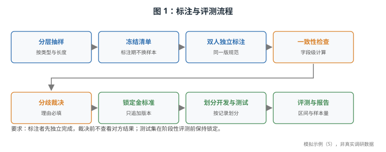
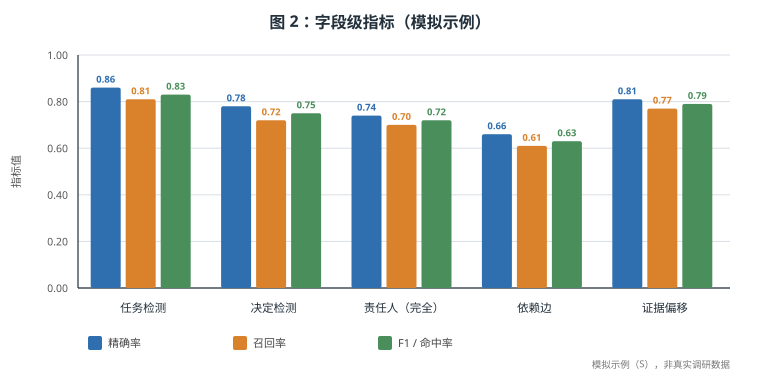
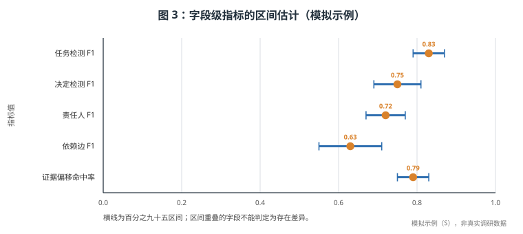
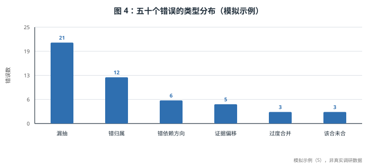

# B-05 抽取质量应如何评测：协议、标注规范与真值来源

| 项目 | 内容 |
| --- | --- |
| 调研人 | Dtao |
| 完成日期 | 2026-11-19 |
| 对应单子 | 资料库「调研任务单」之 B-05-eval-protocol |
| 报告版本 | v1.0 |
| 状态 | 部分完成：协议、规范与指标已定义；双人标注、一致性实测、错误分析与对照实验尚未完成 |

**数据标识说明：** 本报告中的指标数值、区间、错误分布与对照结果均为**模拟示例（S）**，统一标记为“模拟示例（S）”。S 数据仅用于说明协议如何运作，不代表任何模型、任何团队的真实结果，也不构成“准确率”声明。真实双人标注取得后，应以相同口径重算并替换。任务单转引的外部数据（OSynth 归属准确率约 0.69、AMC-A 标注一致性约 0.47）标注为**待核实**，本报告未独立核验原始文献。

**阅读说明：** 第 1 节给出结论；第 2 节界定评测对象与真值来源；第 3 节给出可执行的评测协议；第 4 节说明对标注、裁决与报告界面的影响；第 5 至 7 节列出未决问题、下一步与验收对照；附录提供公式、规范目录与报告模板。

## 摘要

本报告回答三个问题：抽取质量以什么为单位评测、真值从哪里来、指标如何报告才不误导。结论是：评测必须分三层进行，主指标放在**实例层**与**字段层**，记录层只统计覆盖率；真值分为人工双标、人工单标加抽检、合成数据三级，三级结果分表报告，不得混算。

协议的核心是一致性先行。两位标注者按同一份规范独立标注，先计算字段级一致性，再裁决分歧；一致性不达标的字段先修改规范或定义，不进入模型对比。模型指标只报告精确率、召回率与 F1，并附样本量与重采样区间；责任人字段同时报告“完全一致”与“可接受替代”两种口径。测试集按记录划分并锁定，调参阶段不可见。

模拟示例表明，该协议能够区分字段难度、给出区间并暴露错误类型；但双人标注、一致性实测、50 个错误的分类与换模型对照实验尚未执行。因此本报告的结论属于方法层结论，不构成对任何模型准确率的结论。

## 目录

1. 结论 
2. 术语与适用性 
3. 评测协议建议 
4. 对设计的影响 
5. 未决问题 
6. 下一步 
7. 验收对照 
附录 A 公式、规范与模板 
注释

---

## 1. 结论

1. **评测对象分为三层。** 记录层回答“覆盖了多少材料”，实例层回答“任务与决定是否找全、找对”，字段层回答“责任人、依赖、证据是否准确”。主指标放在实例层与字段层，记录层只报告覆盖率与样本构成。
2. **真值分为三级，结果分表报告。** 一级为双人独立标注并经裁决的金标准[1]；二级为单人标注加抽检；三级为合成数据。一级数据可以支持“准确率”表述，二级只能支持“抽检估计”，三级只能支持方法演示。
3. **三十条记录是最小可用集，不是充分集。** 记录按类型（会议、群聊、任务描述）与长度分层抽样[2]，标注量按实例计。建议至少标注三百个任务实例、一百个决定实例，才能按字段分组报告。
4. **一致性先于模型对比。** 使用标注一致性系数[3]衡量两人是否按同一口径标注。任务边界与归属不低于 0.6，依赖方向与证据偏移不低于 0.5；未达标的字段先改规范，不进入模型评测。
5. **指标只使用结构化口径。** 任务与决定检测报告精确率[4]、召回率[5]与 F1[6]；责任人报告“完全一致”与“可接受替代”[7]双口径；依赖边报告带方向的 F1；证据偏移[8]报告命中率。通用文本相似度指标不作为主指标。
6. **必须报告不确定性。** 使用重采样[9]估计指标的置信区间[10]，同时报告样本量。只给点估计的评测结果不得用于上线判断。
7. **测试集按记录划分并锁定。** 开发集与测试集[11]的比例建议为七比三，按记录划分而不是按断言划分；测试集只在阶段性评测时打开，调参阶段界面不显示其指标。
8. **换模型结论必须看区间。** 两次评测的置信区间重叠时，只能表述为“未观察到显著差异”，不得表述为“变好”。错误分类固定为六类，覆盖不少于九成的实际错误。

## 2. 术语与适用性

### 2.1 评测对象的三层结构

抽取系统的输出是一组结构化实例。评测需要先明确在哪一层比较，否则“准确率”无法定义。

| 层级 | 评测单位 | 回答的问题 | 主要指标 | 在本项目中的用途 |
| --- | --- | --- | --- | --- |
| 记录层 | 一份会议记录、一段群聊、一条任务描述 | 材料是否被读取、是否产生输出 | 覆盖率、空输出率、解析失败率 | 判断数据是否可用，不作为质量结论 |
| 实例层 | 一个任务、一个决定、一条依赖边 | 该找的是否找到，是否多找 | 检测精确率、召回率、F1 | 主指标，支撑“抽取是否可用” |
| 字段层 | 实例的一个字段，如责任人、截止时间、证据位置 | 字段值是否正确 | 字段准确率、可接受替代率、证据偏移正确率 | 定位错误来源，指导改规范或改提示词 |

三层的关系是包含关系：记录层回答输入是否有效，实例层回答对象是否找对，字段层回答属性是否填对。报告必须按三层分别呈现，不能用一个总分覆盖。

### 2.2 真值来源的三个等级

真值指用于比较的标准答案。不同来源能支持的结论强度不同。

| 等级 | 获取方式 | 可支持的结论 | 不可支持的结论 | 报告方式 |
| --- | --- | --- | --- | --- |
| 一级：双标金标准 | 两人独立标注，逐条裁决并记录理由 | 字段级准确率、区间估计、模型对比 | 对未标注组织的推广 | 单独成表，注明标注者人数与一致性 |
| 二级：单标加抽检 | 一人标注，另一人抽检两成 | 抽检范围内的误差估计 | 精确的字段级准确率 | 单独成表，注明抽检比例 |
| 三级：合成数据 | 按预设模板生成记录与答案 | 方法可行性、流程演示 | 真实组织验证、产品准确率 | 单独成表，显著标注“合成” |

本报告后续所有数值均属第三级，仅用于演示协议，不得引用为真实准确率。

### 2.3 与通用文本评测的区别

通用文本生成常用相似度指标衡量输出与参考文本的接近程度。结构化抽取的评测目标不同，二者不能互相替代。

| 对比项 | 通用文本相似度指标 | 本报告采用的结构化指标 |
| --- | --- | --- |
| 比较对象 | 整段文本的用词重叠或语义接近 | 实例是否存在、字段值是否相等、边方向是否正确 |
| 对错误的敏感度 | 同义改写不扣分，漏掉关键字段可能不扣分 | 漏抽、错归属、方向错误分别计错 |
| 适用结论 | 文本流畅度、摘要接近度 | 能否支撑负载计算与风险面板 |
| 使用限制 | 不能说明字段是否正确 | 需要金标准与标注规范 |

任务单明确要求不以文本相似度指标代替结构化指标；如使用，只能作为辅助参考，不能出现在主表中。

### 2.4 适用条件与失效条件

适用条件：记录能够获得授权并脱敏[12]；同一批记录有明确的 schema 版本；标注者理解业务语境；评测脚本与数据版本可追溯。

失效条件：标注者只有一人且无抽检；记录类型高度单一；schema 在标注期间发生变更；测试集被用于调参；只报告总分不报告样本量。出现任一条件时，评测结果只能作为内部参考，不得对外表述为准确率。

## 3. 评测协议建议

### 3.1 标注单位与字段

标注单位建议采用“实例加字段”，不采用整条记录打分。整条记录打分无法定位错误，也无法指导修改。

| 标注对象 | 标注单位 | 必填字段 | 允许可接受替代的字段 |
| --- | --- | --- | --- |
| 任务 | 一个任务实例 | 标题、责任人、状态、证据位置、关键与否 | 截止时间、所属位置 |
| 决定 | 一个决定实例 | 决定内容、决策人、影响范围、证据位置 | 生效时间 |
| 依赖 | 一条有向边 | 起点、终点、依赖类型、证据位置 | 强度 |
| 位置 | 一个职责集合 | 名称、职责范围、占据者、证据 | 备份状态 |

“可接受替代”指语义等价但字面不同的答案，例如“张至顺”与“张老师”在同一组织内指同一人。该口径必须事先列出，不能在评测后追加。

### 3.2 标注流程

标注流程分为抽样、独立标注、一致性检查、分歧裁决、锁定金标准五步。流程见图 1。

图 1：标注与评测流程。两名标注者独立完成后才可查看对方结果；裁决后的标签锁定为金标准，后续模型评测不得修改。

流程要求如下。第一，抽样完成后冻结记录清单，标注期间不替换样本。第二，两名标注者使用同一版规范，规范版本号写入标注文件。第三，一致性与分歧在裁决前统计，避免裁决结果反向影响独立性。第四，每条裁决必须写明理由，理由字段为必填。第五，金标准锁定后只允许追加版本，不允许原地修改。

### 3.3 一致性检验与分歧裁决

一致性使用标注一致性系数计算，公式见附录 A.2。该系数扣除随机一致的部分，适合两个标注者、多个类别的场景。字段门槛建议如下。

| 字段 | 一致性门槛 | 未达标时的处理 |
| --- | --- | --- |
| 任务是否成立 | 0.60 | 补充正反例，明确最小任务的定义 |
| 任务归属位置 | 0.60 | 补充位置清单与归并规则 |
| 责任人 | 0.60 | 明确“可接受替代”清单 |
| 依赖方向 | 0.50 | 补充方向判定例句 |
| 证据偏移 | 0.50 | 明确证据窗口的起止规则 |
| 决定是否成立 | 0.60 | 明确“决定”与“讨论”的边界 |

裁决规则：两人一致时直接采纳；一人标注、一人缺失时由裁决者补标并说明；两人不一致时并排查看原文，选择其一或改写，并记录理由。裁决者不参与模型评测的参数选择，避免同一人同时决定答案与标准。

### 3.4 抽样与数据划分

抽样采用分层方式：先按记录类型分层，再按长度分为短、中、长三层，每层按比例抽取。记录类型至少覆盖会议记录、群聊记录、任务描述三类。任务单给出的三十条记录是下限，若某层不足五条，应在报告中说明该层结论不稳定。

数据划分以记录为单位，建议七成开发、三成测试。划分后生成固定的划分文件，记录编号写入其中。测试集在阶段性评测前保持锁定，界面上不显示其指标；只有完成一轮协议修订后才打开一次，打开次数记入报告。

### 3.5 指标定义

任务与决定检测使用精确率、召回率与 F1。精确率回答“抽出的实例中有多少是真的”，召回率回答“真实实例中有多少被抽出”，F1 是两者的调和平均。公式见附录 A.2。

责任人使用双口径：完全一致要求字符串归一化后完全相等；可接受替代允许同义指代，但必须命中事先列出的清单。依赖边只有起点、终点、类型三者都正确才计为正确，方向错误单独计入错误类型。

证据偏移指抽取结果所引用的原文位置与金标准位置的偏差。建议以句为窗口：引用句与金标准句相同或相邻计为命中；跨段引用计为偏移。下游指标稳定性使用 Top-5 风险集合的重合度衡量，重合度采用 Jaccard 相似度[13]，即两个集合的交集大小除以并集大小。

模拟示例如图 2。图中数值为模拟示例（S），仅用于说明字段间差异如何呈现，不代表真实模型表现。

图 2：字段级精确率、召回率与 F1（模拟示例 S）。任务检测最高，依赖边最低；字段间差异说明评测必须分字段报告。

### 3.6 不确定性与稳定性

点估计不能反映小样本波动。协议要求对记录进行有放回重采样，重复不少于一千次，取百分之二点五与百分之九十七点五分位作为区间。区间宽度过大时，应增加样本而不是宣称模型稳定。

同一模型至少独立运行两次，比较两次的下游 Top-5 风险集合。Jaccard 低于 0.6 时，该次评测不得用于上线判断。模型温度、提示词版本、解析规则均需固定并写入报告。

模拟区间如图 3。图中区间为模拟示例（S），仅用于说明区间如何与点估计一同呈现。

图 3：字段级指标的区间估计（模拟示例 S）。区间重叠的字段不能判定为存在差异；区间宽度反映样本量是否充分。

### 3.7 错误分类

错误分类的作用是指导下一步动作。固定六类：漏抽、错归属、错依赖方向、证据偏移、过度合并、该合未合。每类对应不同的修改方向。

| 错误类型 | 定义 | 典型修改方向 |
| --- | --- | --- |
| 漏抽 | 真实任务或决定未被抽出 | 补充提示词中的触发表达，检查记录解析 |
| 错归属 | 实例存在但责任人、位置或决策人错误 | 补充归属规则与指代消解[14] |
| 错依赖方向 | 依赖关系存在但起点与终点颠倒 | 增加方向判定例句，区分“先做”与“属于” |
| 证据偏移 | 引用位置与原文不符 | 要求引用原句，限制改写 |
| 过度合并 | 不同任务被合并为一条 | 收紧合并阈值，增加反例 |
| 该合未合 | 同一任务多次出现但未合并 | 放宽阈值，补充同义表达 |

模拟错误分布如图 4。图中数量为模拟示例（S），仅用于说明错误分析如何呈现。

图 4：五十个错误的类型分布（模拟示例 S）。漏抽与错归属占比最高，应优先修改提示词与归属规则。

错误分析要求至少检查五十个错误，逐条给出类型、原文、模型输出与金标准。六类覆盖不足九成时，剩余错误归入“未解释”，并说明可能的成因。

### 3.8 换模型对照实验

对照实验使用同一数据版本、同一划分、同一评测脚本，只更换模型或提示词版本。比较时按字段查看差值与区间，不以总分排序。判断规则：区间不重叠且差值方向一致，才可表述为“该字段有改善”；区间重叠时表述为“未观察到显著差异”。

对照实验至少包含一次“同模型重复运行”，用于估计评测本身的波动下限。若两次重复运行的差异大于模型更换带来的差异，则说明评测精度不足，应先扩大样本。

## 4. 对设计的影响

### 4.1 标注界面

界面需要支持领取任务、逐字段标注、引用原文、提交与查看自己的分歧。引用原文应采用句级选择，而不是自由复制，以保证证据偏移可计算。标注界面必须显示 schema 版本与规范版本，版本不一致时禁止提交。

### 4.2 裁决界面

裁决界面并排显示两人结果，按一致、不一致、一方缺失三种状态着色。裁决结果与理由均为必填；理由字段建议提供常用理由选项，同时允许自由填写。裁决记录只追加，不覆盖。

### 4.3 报告页

报告页按三层组织：顶部为样本构成与覆盖率，中部为实例层与字段层指标及区间，底部为错误分布与错误样例入口。每个指标必须附样本量；样本量不足时置灰并说明原因，不显示为绿色。

### 4.4 版本锁定与测试集保护

每次评测生成一份版本记录，包含数据版本、schema 版本、提示词版本、模型名称、参数与脚本命令。缺少任一项的记录不得进入对比页。测试集指标默认隐藏，只有标记为“阶段性评测”的运行才展示，并记录打开时间与操作人。

## 5. 未决问题

| 未决项 | 状态 | 原因 | 下一步 |
| --- | --- | --- | --- |
| 双人标注是否可行 | 未做 | 需要两名了解业务的成员与时间 | 先在一个团队试点三十条记录 |
| 三十条记录的字段样本量 | 未定 | 任务与决定的密度未知 | 预标注十条，估算每条的实例数 |
| 可接受替代清单 | 未定 | 需要真实姓名与称谓样本 | 从脱敏记录中整理候选清单 |
| 证据窗口粒度 | 未定 | 句级与段级各有取舍 | 用十条记录做双口径对比 |
| 依赖方向一致性 | 未验证 | 依赖实例少，可能不足统计 | 扩大决定类记录比例 |
| 测试集泄漏风险 | 未评估 | 记录可能被重复引用 | 按来源文档聚簇划分 |
| 错误分类的稳定性 | 未验证 | 需要至少五十个真实错误 | 首轮评测后复核分类 |
| 报告模板的可用性 | 未验证 | 尚未给第三人试用 | 由第三人按模板复现一次 |

## 6. 下一步

1. 完成十条记录的预标注，估算任务与决定的实例密度，据此确定三十条记录是否足够。
2. 编写标注规范 v1，包含字段定义、正反例、可接受替代清单与证据窗口规则。
3. 组织两名标注者独立标注，计算字段级一致性，逐条裁决并记录理由。
4. 实现指标脚本与重采样区间，固定数据划分并锁定测试集。
5. 完成首轮评测，检查至少五十个错误并按六类归档。
6. 做一次同模型重复运行与一次换提示词对照，验证指标能否区分差异。

## 7. 验收对照

| 验收标准 | 结果 | 说明 |
| --- | --- | --- |
| 双人一致性不低于 0.6，争议字段有裁决规则 | 未完成 | 规则已定义，尚未实测 |
| 同一模型两次运行，Top-5 风险集合重合度不低于 0.6 | 未完成 | 需真实记录与两次运行 |
| 错误分类覆盖不少于九成，其余归入未解释 | 未完成 | 需至少五十个真实错误 |
| 第三人可按报告复现评测 | 方法通过，未实测 | 版本字段与命令模板已定义 |
| 不以文本相似度指标代替结构化指标 | 通过 | 主表只含结构化指标 |
| 合成数据与真实数据分表报告 | 通过 | 已设三级真值表与标注要求 |

## 附录 A 公式、规范与模板

### A.1 术语与符号

| 术语 | 含义 |
| --- | --- |
| 真值 | 用于比较的标准答案，本报告分为三级 |
| 实例 | 一个任务、一个决定或一条依赖边 |
| 字段 | 实例的一个属性，如责任人、截止时间 |
| 金标准 | 经双人标注与裁决后锁定的真值集合 |
| 开发集 | 允许用于调参与查看指标的数据划分 |
| 测试集 | 仅在阶段性评测时打开的数据划分 |
| 证据偏移 | 抽取结果引用位置与标准位置之间的偏差 |

### A.2 公式与算例

精确率、召回率与 F1：

P = TP ÷ (TP + FP)

R = TP ÷ (TP + FN)

F1 = 2 × P × R ÷ (P + R)

其中 TP 为正确抽出的实例数，FP 为错误抽出的实例数，FN 为漏抽的实例数。算例：TP 为 40，FP 为 10，FN 为 12，则 P 为 0.80，R 为 0.77，F1 为 0.78。

标注一致性系数：

κ = (Po − Pe) ÷ (1 − Pe)

其中 Po 为两人实际一致比例，Pe 为按各类别边际分布计算的随机一致比例。算例：两人在 100 个实例上一致 80 个，随机一致比例为 0.5，则 κ 为 0.60。

Jaccard 相似度：

J(A, B) = |A ∩ B| ÷ |A ∪ B|

算例：两次运行的 Top-5 风险集合交集为 4，并集为 6，则 J 为 0.67，达到展示门槛。

### A.3 标注规范 v1 目录

1. 适用范围与版本规则。
2. 任务的定义、最小粒度与正反例。
3. 决定的定义，与讨论、建议的区分。
4. 责任人规则与可接受替代清单。
5. 依赖方向规则与典型例句。
6. 证据引用的句级规则与偏移判定。
7. 不确定情况的标注方式。
8. 分歧裁决流程与理由写法。

### A.4 错误分类表

| 编号 | 类型 | 判定要点 | 修改方向 |
| --- | --- | --- | --- |
| E1 | 漏抽 | 金标准有、模型无 | 触发表达、解析完整性 |
| E2 | 错归属 | 实例对、责任人错 | 指代消解、归属规则 |
| E3 | 错依赖方向 | 边对、方向反 | 方向例句、句法线索 |
| E4 | 证据偏移 | 引用位置不符 | 限定引用原句 |
| E5 | 过度合并 | 多任务合成一条 | 收紧阈值、反例 |
| E6 | 该合未合 | 同一任务多条 | 放宽阈值、同义表达 |

### A.5 评测报告模板

| 区块 | 必填内容 |
| --- | --- |
| 基本信息 | 数据版本、schema 版本、提示词版本、模型、参数、脚本命令 |
| 样本 | 记录数、实例数、字段数、划分比例 |
| 主指标 | 字段级 P、R、F1 与区间 |
| 稳定性 | 重复运行的 Top-5 重合度 |
| 错误 | 六类分布、典型样例编号 |
| 结论 | 可用、不可用或需补样本，附依据 |

### A.6 抽样表模板

| 记录编号 | 类型 | 长度档 | 任务数 | 决定数 | 是否进入测试集 |
| --- | --- | --- | --- | --- | --- |
| R-001 | 会议 | 中 | 4 | 2 | 否 |
| R-002 | 群聊 | 短 | 2 | 0 | 是 |
| R-003 | 任务描述 | 短 | 1 | 0 | 否 |

## 注释

1. **金标准：** 经两名标注者独立标注、逐条裁决后锁定的标准答案集合。金标准一旦锁定，只允许追加版本，不允许原地修改。
2. **分层抽样：** 先按记录类型与长度分组，再在各组内按比例抽取样本的方法。其作用是避免某类记录在评测中缺失或被过度代表。
3. **标注一致性系数：** 扣除随机一致部分后衡量两名标注者一致程度的统计量，常用符号为 κ。取值越低，说明标注口径越不稳定。
4. **精确率：** 抽出的实例中真正正确的比例，回答“抽出来的有多少是对的”。
5. **召回率：** 真实实例中被抽出的比例，回答“该抽的抽到了多少”。
6. **F1：** 精确率与召回率的调和平均，用于在两者之间取平衡。调和平均对较低的一项更敏感。
7. **可接受替代：** 语义等价但字面不同的答案，例如同一人的姓名与常用称谓。清单必须事先确定。
8. **证据偏移：** 抽取结果引用的原文位置与标准位置之间的偏差。本报告以句为窗口判定是否命中。
9. **重采样：** 从现有样本中有放回地反复抽取子样本，用以估计统计量波动的方法，常用 bootstrap 指代。
10. **置信区间：** 在一定置信水平下包含真实值的区间。本报告使用百分之九十五置信水平。
11. **开发集与测试集：** 开发集允许查看指标并用于调参；测试集在调参阶段锁定，只用于阶段性评测，以防止过拟合。
12. **脱敏：** 移除或替换可识别个人身份的信息，保留结构与统计特征。
13. **Jaccard 相似度：** 两个集合的交集大小除以并集大小，取值在零到一之间，用于衡量集合重合程度。
14. **指代消解：** 判断代词或称谓指向哪个人或哪个实体的处理过程，例如判断“他”指谁。

## AI 使用说明

- 是否使用：是
- 使用工具：Qoder
- 参与环节：资料整理、结构与初稿撰写、图表生成与排版
- 人工核验方式：待调研人 Dtao 核对来源、数据与结论
- 本人确认：待调研人签署确认
