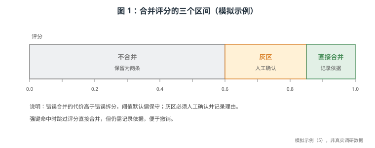
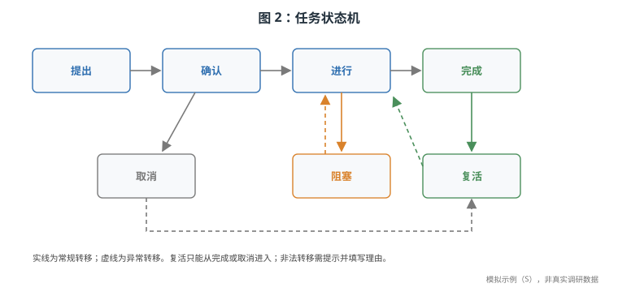
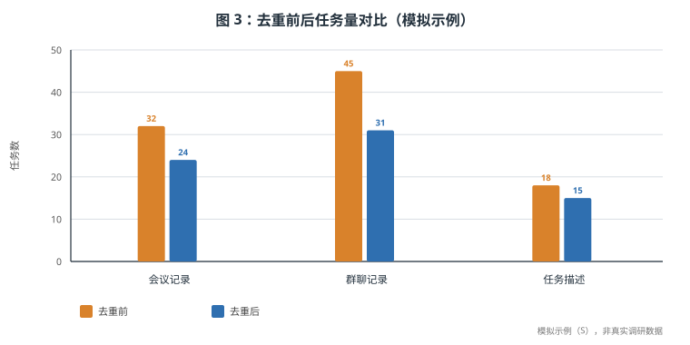
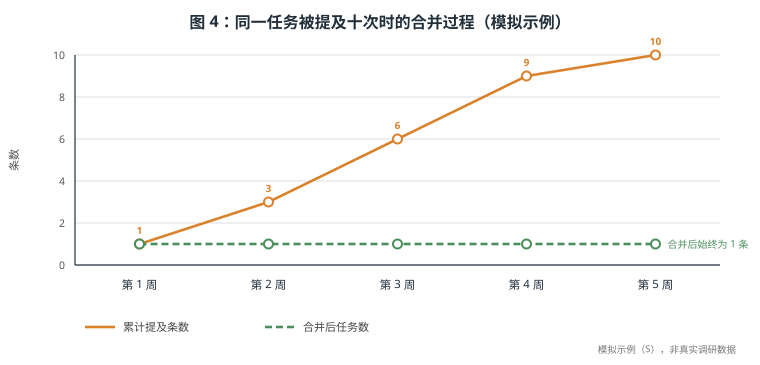

# B-07 同一任务跨记录应如何去重、演化与合并

| 项目 | 内容 |
| --- | --- |
| 调研人 | Dtao |
| 完成日期 | 2026-11-19 |
| 对应单子 | 资料库「调研任务单」之 B-07-task-dedup |
| 报告版本 | v1.0 |
| 状态 | 部分完成：合并规则、状态机与证据链结构已定义；50+50 对照集、极端重复测试与去重前后实测尚未完成 |

**数据标识说明：** 本报告中的任务数量、合并比例、偏差率与图表数值均为**模拟示例（S）**，统一标记为“模拟示例（S）”。S 数据仅用于说明规则如何运作，不代表任何真实团队的任务清单，也不作为调研证据。真实记录取得后，应以相同口径重算并替换。

**阅读说明：** 第 1 节给出结论；第 2 节区分四类容易混淆的任务关系；第 3 节给出合并规则、阈值与状态机；第 4 节说明对时间线、合并卡与指标的影响；第 5 至 7 节列出未决问题、下一步与验收对照；附录提供公式、状态转移表与对照集构建方法。

## 摘要

本报告回答一个直接影响负载可信度的问题：同一件事在周一、周三、周五被分别提到，系统应依据什么判断它们是同一任务，以及合并之后状态与证据如何保留。结论是：合并判定采用五因素加权，不使用单一文本相似度；合并键分为强键与弱键，强键直接合并，弱键进入人工确认；阈值默认偏向保守，因为错误合并的代价高于错误拆分。

任务状态固定为七个：提出、确认、进行、阻塞、完成、取消、复活。状态之间允许的转移以表格固定，非法转移给出提示而不静默接受。父子关系与前置依赖分开表达：前者表示“B 是 A 的一部分”，后者表示“先做 A 才能做 B”，二者使用不同的边类型与语言线索。

合并只建立关联，不覆盖原始记录。每条合并后的任务保留全部原始提及、来源数与最后更新时间，用户可展开查看每一次提及与证据。去重前后必须对比任务量、负载与 Top-5 风险；任务量偏差超过两成时，视为合并规则失效并回退。

模拟示例表明，该规则能够把措辞各异的多次提及合并为一条并保留证据；但 50+50 对照集、极端重复测试与去重前后实测尚未执行，因此本报告的结论属于方法层结论。

## 目录

1. 结论 
2. 术语与适用性 
3. 合并与状态规则建议 
4. 对设计的影响 
5. 未决问题 
6. 下一步 
7. 验收对照 
附录 A 公式、状态表与模板 
注释

---

## 1. 结论

1. **合并判定采用五因素加权。** 动作动词、对象名词、责任人、时间邻近、上下文共现共同决定两条记录是否指向同一任务；单一文本相似度只作为辅助特征，不作为唯一依据。
2. **合并键分为强键与弱键。** 强键包括明确编号、明确引用、同一对象加同一截止时间；强键命中时直接合并。弱键需要综合评分，评分落在灰区时进入人工确认。
3. **阈值默认偏保守。** 错误合并会把两件事并成一件，导致负载、依赖与风险同时失真；错误拆分只增加条数，较易通过人工发现。默认合并阈值为 0.85，0.60 至 0.85 为灰区[1]，低于 0.60 不合并。
4. **状态机固定为七态。** 提出、确认、进行、阻塞、完成、取消、复活[2]；每次状态变化记录时间、操作人与依据，不覆盖历史状态。
5. **父子与前置依赖分开。** 包含关系与先后关系使用不同边类型；前者回答任务由哪些部分组成，后者回答执行顺序。
6. **证据链只追加。** 合并建立关联而不是删除记录；每条任务保留全部提及、来源数、首次提出时间与最后更新时间。
7. **负载只计未完成任务。** 完成与取消的任务保留在时间线中，但不计入当前负载；复活任务从复活时间起重新计入。
8. **去重前后必须对比。** 任务量、人均负载、Top-5 风险集合三项同时对比；任务量偏差超过百分之二十时回退规则并检查样本。

## 2. 术语与适用性

### 2.1 四类容易混淆的任务关系

同一段材料中出现的多条任务描述，可能属于四种不同关系。混淆会导致错误合并或错误拆分。

| 关系 | 判定依据 | 典型语言线索 | 处理方式 |
| --- | --- | --- | --- |
| 同一任务 | 动作、对象、责任人一致，时间相近 | “还是上次那件事”“继续跟进” | 合并为一条，保留多次提及 |
| 相似但不同 | 动作相近，对象不同 | “整理报名表”与“整理签到表” | 不合并，标记为相似任务 |
| 父子任务 | 一条任务是另一条的组成部分 | “其中”“包括”“拆成” | 建立包含关系，不合并 |
| 前置依赖 | 完成一条才能开始另一条 | “先……再……”“等……之后” | 建立有向依赖，不合并 |

四类关系必须在数据模型中有不同表示。把父子任务合并会丢失结构，把前置依赖合并会丢失顺序。

### 2.2 与事件共指、任务跟踪器的关系

事件共指[3]研究同一事件在不同文本中的多次提及如何归并，其方法可以借鉴，但目标不同：事件共指关注“是否同一事件”，本任务还要保留状态演化与责任归属。

任务跟踪器的生命周期提供了状态命名的参照。开源与商业任务系统通常包含待办、进行、完成、取消等状态，但较少处理“同一任务在聊天中被多次随口提及”的场景。本报告的状态机在此基础上增加了“提出”和“复活”两个状态。

| 对比项 | 事件共指 | 任务跟踪器 | 本报告的合并规则 |
| --- | --- | --- | --- |
| 处理对象 | 文本中的事件提及 | 已创建的任务条目 | 跨记录的任務提及与任务实例 |
| 核心判断 | 是否同一事件 | 状态流转 | 是否同一任务，以及状态如何演化 |
| 证据保留 | 提及集合 | 操作历史 | 提及集合加状态历史 |
| 主要风险 | 过度合并 | 状态失真 | 两者兼有 |

### 2.3 适用条件与失效条件

适用条件：记录中存在可识别的动作与对象；同一任务至少出现两次；记录时间可比较；责任人可识别或可标注为未知。

失效条件：任务命名高度不一致且无上下文；记录跨越过长的时间窗；组织处于频繁重组阶段；用户把合并结果用于个人产出统计。出现任一条件时，合并结果只能作为候选，必须人工确认。

## 3. 合并与状态规则建议

### 3.1 合并判定的五个因素

合并评分由五个因素加权求和，权重建议如下。权重是初始值，需用 50+50 对照集校准。

| 因素 | 作用 | 初始权重 | 说明 |
| --- | --- | --- | --- |
| 动作动词 | 判断是否在做同一类事 | 0.25 | “整理”“提交”“确认”等，需做同义词归一 |
| 对象名词 | 判断作用对象是否相同 | 0.30 | 权重最高，对象不同通常不是同一任务 |
| 责任人 | 判断承担者是否一致 | 0.15 | 责任人未知时不扣分，按剩余权重归一 |
| 时间邻近 | 判断是否处于同一工作周期 | 0.15 | 超过时间窗[4]则该项为零 |
| 上下文共现 | 判断是否在同一讨论串中被提及 | 0.15 | 同一会议、同一群聊话题视为共现 |

评分公式见附录 A.2。分数只用于排序与分档，不直接作为“同一任务”的证明；每一档都必须有对应的处理动作。

### 3.2 合并键与阈值

强键命中时跳过评分，直接合并。强键包括：记录中出现明确编号；后一条记录明确引用前一条；对象与截止时间同时相同。强键合并仍需记录依据，便于撤销。

弱键按评分分三档处理，如图 1。图中数值为模拟示例（S），仅用于说明分档方式。

图 1：合并评分的三个区间（模拟示例 S）。直接合并区不做人工确认，灰区必须人工确认，不合并区直接保留为两条。

| 区间 | 分数范围 | 处理动作 | 记录要求 |
| --- | --- | --- | --- |
| 直接合并 | 不低于 0.85 | 自动合并 | 记录命中的强键或高分因素 |
| 灰区 | 0.60 至 0.85 | 人工确认 | 展示并排对比与差异高亮 |
| 不合并 | 低于 0.60 | 保留两条 | 可标记为相似任务，供后续参考 |

阈值偏向保守的原因：错误合并会同时改变任务量、负载与依赖，且不易被用户发现；错误拆分只会增加条数，用户可以一眼看出重复并手动合并。

### 3.3 相似但不同的反例规则

以下情形默认不合并，除非强键命中。

| 情形 | 示例 | 规则 |
| --- | --- | --- |
| 对象不同 | 整理报名表与整理签到表 | 对象名词不同，评分封顶 0.55 |
| 阶段不同 | 起草方案与评审方案 | 动作不同，视为同一任务的不同阶段，建立阶段关系而非合并 |
| 责任人不同 | 甲负责采购、乙负责验收 | 责任人不同且对象不同，不合并 |
| 时间跨度过大 | 三月的“更新名单”与十一月的“更新名单” | 超出时间窗，不合并 |
| 否定表述 | “不再跟进供应商”与“跟进供应商” | 否定词改变任务含义，不合并 |

否定表述需要单独处理。抽取阶段应保留否定标记，合并阶段遇到否定不一致时直接判定为不同任务。

### 3.4 状态机

任务状态固定为七个：提出、确认、进行、阻塞、完成、取消、复活。状态机[5]如图 2。

图 2：任务状态机。实线为常规转移，虚线为异常转移；复活只能从完成或取消进入。

允许的转移如下：提出可进入确认或取消；确认可进入进行、阻塞或取消；进行可进入阻塞、完成或取消；阻塞可回到进行或取消；完成可进入复活；取消可进入复活。其余转移视为非法，界面给出提示并要求填写理由。

状态判定以记录中的明确表述为准。“已安排”“准备做”归入确认；“正在做”“已开始”归入进行；“卡在”“等对方”归入阻塞；“已完成”“已交付”归入完成；“不做了”“取消”归入取消。含糊表述不改变状态，保留原状态并标记待确认。

### 3.5 父子关系与前置依赖

两类关系使用不同边类型，不能共用一种“关联”。

| 关系 | 边类型 | 语言线索 | 对指标的影响 |
| --- | --- | --- | --- |
| 包含 | 父子边 | “其中”“包括”“拆成”“分为” | 父任务负载为子任务之和，不重复计算 |
| 前置 | 依赖边 | “先……再……”“等……之后”“需要先” | 影响关键路径与阻塞风险 |

判断顺序建议：先判断是否包含，再判断是否前置。包含关系通常伴随整体与部分的名词结构；前置关系通常伴随时间先后与条件结构。

### 3.6 证据链结构

合并后的任务必须能展开查看全部原始提及。证据链[6]字段建议如下。

| 字段 | 含义 | 是否必填 |
| --- | --- | --- |
| 任务编号 | 合并后任务的稳定编号 | 是 |
| 原始提及编号 | 每次提及的唯一编号 | 是 |
| 记录编号与位置 | 来源记录及句级位置 | 是 |
| 提及时间 | 该次提及的发生时间 | 是 |
| 提及原文 | 原句摘录，不改写 | 是 |
| 合并依据 | 强键或评分因素 | 是 |
| 状态变化 | 该次提及是否伴随状态变化 | 否 |

合并只追加关联，不删除原始记录。拆分时按关联解除，原始提及仍保留在原记录中。

### 3.7 去重前后的评估

评估四项：错误合并率、错误拆分率、任务量偏差、人工确认工作量。前两项用 50+50 对照集计算；第三项与人工计数比较；第四项统计灰区进入人工确认的比例。

模拟对比见图 3 与图 4。图中数值为模拟示例（S），仅用于说明对比方式。

图 3：三类记录去重前后的任务量（模拟示例 S）。群聊记录的重复提及最多，去重后任务量下降最明显。

图 4：同一任务被提及十次时的累计提及数与合并后任务数（模拟示例 S）。合并后任务数保持为一条，提及数持续增长，证据链完整保留。

任务量偏差的计算方式为：去重后任务数与人工计数之差的绝对值，除以人工计数。偏差超过百分之二十时，优先检查阈值是否过松或对象名词归一是否不足。

### 3.8 极端重复测试

测试方法：构造同一任务被提及十次、措辞各异的材料，检查系统是否合并为一条，以及证据链是否保留十次提及。通过标准为合并为一条且提及数不少于十。若出现两条以上，检查是否因对象表述差异导致评分不足；若出现零条，检查解析是否失败。

该测试同时用于检查状态演化：十次提及中应包含提出、进行、完成等状态，时间线应完整呈现，不得只保留最后状态。

## 4. 对设计的影响

### 4.1 任务时间线

时间线按时间顺序展示每次提及，标注说话人、原文摘要与状态变化。顶部显示来源数与最后更新时间，避免用户把合并后的任务误认为新任务。时间线支持按状态筛选，但不支持删除提及。

### 4.2 合并建议卡

合并建议卡并排显示两条记录，差异部分高亮，并说明“为什么认为是同一件事”。说明文字应列出命中的因素与分数，而不是只给一个总分。卡片提供合并、不合并、拆分三个动作，合并时可选择保留哪个标题与哪个截止时间。

### 4.3 拆分与撤销

拆分时显示将解除的关联与受影响的指标，确认后执行。合并与拆分均可撤销，撤销记录进入操作历史。撤销不删除任何原始提及。

### 4.4 指标联动

任务量、负载与 Top-5 风险在合并或拆分后立即重算，并显示变化前后对比。变化超过预设幅度时提示用户复核，避免一次误操作导致指标大幅波动。

## 5. 未决问题

| 未决项 | 状态 | 原因 | 下一步 |
| --- | --- | --- | --- |
| 五因素权重 | 未校准 | 缺少 50+50 对照集 | 构建对照集后回归校准 |
| 灰区宽度 | 未定 | 取决于人工确认成本 | 用对照集统计不同宽度的错误率 |
| 时间窗长度 | 未定 | 不同团队节奏差异大 | 按团队配置，默认三十天 |
| 对象名词归一 | 未实现 | 需要同义词表 | 从真实记录中整理对象词表 |
| 否定表述处理 | 未验证 | 样本不足 | 在对照集中增加否定样例 |
| 状态机覆盖率 | 未验证 | 需要二十条真实状态序列 | 标注后统计非法转移比例 |
| 负载去重口径 | 未统一 | 父子任务与共享任务并存 | 与 B-02 位置模型对齐 |
| 人工确认工作量 | 未测量 | 需要真实灰区样本 | 统计每百条任务的确认次数 |

## 6. 下一步

1. 从三十条记录中整理 50 组同一任务与 50 组相似但不同的对照，形成固定测试集。
2. 用对照集校准五因素权重与灰区宽度，记录每档的错误合并率与错误拆分率。
3. 标注二十个任务的状态序列，验证七态状态机能否覆盖真实转移。
4. 实现证据链与合并撤销，确保任何一次合并都能展开并回退。
5. 执行极端重复测试与去重前后对比，计算任务量、负载与 Top-5 风险的变化。
6. 与 B-02 位置模型对齐负载口径，明确父子任务与共享任务的计算方式。

## 7. 验收对照

| 验收标准 | 结果 | 说明 |
| --- | --- | --- |
| 抽检 50 组，错误合并不高于一成 | 未完成 | 规则已定义，尚未实测 |
| 抽检 50 组，错误拆分不高于一成 | 未完成 | 需对照集与人工判定 |
| 去重后任务量与人工计数偏差不高于两成 | 未完成 | 需真实记录与人工计数 |
| 每条合并任务可展开全部提及与证据 | 通过 | 证据链字段已定义 |
| 状态机覆盖不少于九成真实序列 | 未完成 | 需标注二十条状态序列 |
| 非法状态转移有提示 | 通过 | 转移表与提示规则已定义 |
| 合并与拆分可撤销 | 通过 | 采用追加式关联与操作历史 |

## 附录 A 公式、状态表与模板

### A.1 术语与符号

| 术语 | 含义 |
| --- | --- |
| 提及 | 一条记录中对某个任务的一次描述 |
| 合并 | 将多次提及关联为一条任务，不删除原始记录 |
| 拆分 | 解除合并关联，恢复为多条任务 |
| 强键 | 命中后可直接合并的判定依据 |
| 灰区 | 需要人工确认的评分区间 |
| 证据链 | 合并任务所关联的全部原始提及与依据 |

### A.2 合并评分公式与算例

S = w1 × a + w2 × o + w3 × p + w4 × t + w5 × c

其中 a 为动作相似度，o 为对象相似度，p 为责任人一致度，t 为时间邻近度，c 为上下文共现度；五项取值均在零到一之间；w 为权重，权重之和为一。责任人未知时，将该项权重按比例分配到其余四项。

算例：a 为 0.9，o 为 0.8，p 为 1.0，t 为 0.9，c 为 0.7，按初始权重计算，S 为 0.86，进入直接合并区。

任务量偏差：

D = |N去重 − N人工| ÷ N人工

算例：去重后为 62 条，人工计数为 55 条，则 D 为 0.127，低于两成，视为通过。

Top-5 风险变化使用 Jaccard 相似度：

J(A, B) = |A ∩ B| ÷ |A ∪ B|

算例：去重前 Top-5 与去重后 Top-5 交集为 4，并集为 6，则 J 为 0.67。

### A.3 状态转移表

| 当前状态 | 允许进入 | 说明 |
| --- | --- | --- |
| 提出 | 确认、取消 | 任务刚被提及 |
| 确认 | 进行、阻塞、取消 | 已明确要做 |
| 进行 | 阻塞、完成、取消 | 正在执行 |
| 阻塞 | 进行、取消 | 等待外部条件 |
| 完成 | 复活 | 已交付 |
| 取消 | 复活 | 明确不做 |
| 复活 | 进行、阻塞、取消 | 重新开始 |

### A.4 50+50 对照集构建方法

1. 从会议、群聊、任务描述三类记录中抽取任务提及，覆盖短、中、长三种长度。
2. 由两名成员独立判断每对提及是否同一任务，不一致的逐条讨论并记录理由。
3. 同一任务组与相似但不同组各保留五十组，组内提及不少于两条。
4. 对照集固定后不再修改；新增样例进入扩展集，单独报告结果。
5. 每组标注判定依据，至少包含动作、对象、责任人、时间四项中的三项。

### A.5 合并记录模板

| 字段 | 内容 |
| --- | --- |
| 合并编号 | 稳定编号 |
| 涉及提及 | 提及编号列表 |
| 合并方式 | 强键或评分 |
| 评分与因素 | 各因素取值与总分 |
| 操作人 | 自动或人工账号 |
| 操作时间 | 时间戳 |
| 撤销状态 | 未撤销或已撤销 |

### A.6 评估指标定义

| 指标 | 定义 | 目标 |
| --- | --- | --- |
| 错误合并率 | 被错误合并的组数除以合并总组数 | 不高于一成 |
| 错误拆分率 | 应合并而未合并的组数除以应合并组数 | 不高于一成 |
| 任务量偏差 | 去重后与人工计数的相对偏差 | 不高于两成 |
| 确认工作量 | 进入灰区的任务数除以任务总数 | 越低越好，需与错误率权衡 |

## 注释

1. **灰区：** 评分处于“直接合并”与“不合并”之间的区间。落入灰区的记录不自动处理，必须由人工确认。
2. **复活：** 已完成或已取消的任务重新进入执行状态。复活需要记录原因与新的截止时间。
3. **事件共指：** 判断不同文本中的多次提及是否指向同一事件的处理任务，是自然语言处理中的常见问题。
4. **时间窗：** 判断两次提及是否可能属于同一任务的时间范围。本报告建议默认三十天，可按团队节奏调整。
5. **状态机：** 用状态与允许的转移描述对象生命周期的模型。状态机可以检查非法跳转并保留历史。
6. **证据链：** 合并任务与全部原始提及之间的可追溯关联。证据链只追加，不覆盖原始记录。

## AI 使用说明

- 是否使用：是
- 使用工具：Qoder
- 参与环节：资料整理、结构与初稿撰写、图表生成与排版
- 人工核验方式：待调研人 Dtao 核对来源、数据与结论
- 本人确认：待调研人签署确认
