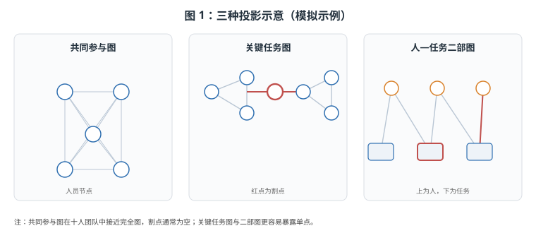
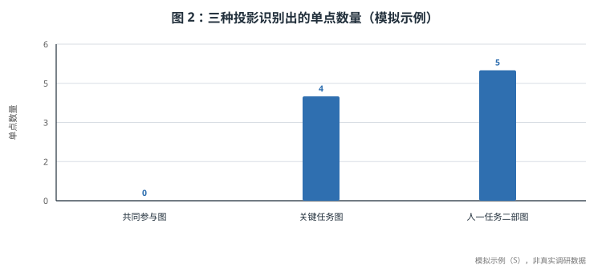
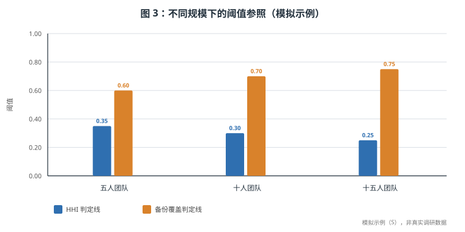
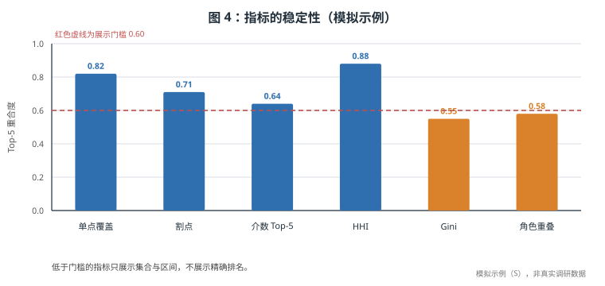
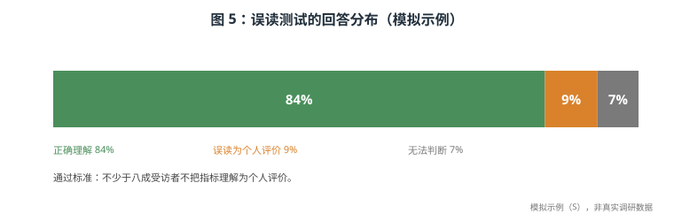

# B-09 单点承担、依赖集中与角色重叠应如何度量

| 项目 | 内容 |
| --- | --- |
| 调研人 | Dtao |
| 完成日期 | 2026-11-19 |
| 对应单子 | 资料库「调研任务单」之 B-09-metrics-thresholds |
| 报告版本 | v1.0 |
| 状态 | 部分完成：指标定义、投影选择与阈值规则已定义；真实图计算、bootstrap 实测、盲评与误读测试尚未完成 |

**数据标识说明：** 本报告中的指标数值、稳定性系数、盲评一致率与误读比例均为**模拟示例（S）**，统一标记为“模拟示例（S）”。S 数据仅用于说明指标如何呈现与比较，不代表任何真实团队，也不作为效度证据。真实计算取得后，应以相同口径重算并替换。任务单转引的文献（Freeman、Brandes、Tarjan、Lengauer 与 Tarjan、Burt、Dunn 等）标注为**待核实**，本报告未逐篇核验原文。

**阅读说明：** 第 1 节给出结论；第 2 节说明小样本对指标的影响与三种投影；第 3 节给出指标定义、阈值分档与稳定性规则；第 4 节说明对风险面板的影响；第 5 至 7 节列出未决问题、下一步与验收对照；附录提供公式、完整指标表与测试提纲。

## 摘要

本报告回答三个问题：十人左右的团队应当使用哪些结构指标、阈值如何确定、哪些指标不应展示。结论是：共同参与图在十人团队中接近完全图，割点[1]常为空，主投影应改为“关键任务图”，辅助使用“人—任务二部图”；指标按位置层、结构层、团队层三层组织，每个指标必须写明适用规模、失效条件与解释话术。

阈值采用双轨：绝对阈值只用于展示，判定使用分位数与零模型对比。同一指标在五人、十人、十五人三档分别给出参照，不能只给一个数。稳定性使用重采样评估，Top-5 风险集合的重合度低于 0.6 时，不允许展示精确排名，只展示集合与区间。

指标需要去冗余：HHI 与 Gini 高度相关，保留其一；介数与割点部分重叠，分层展示。面板最多六个指标，分三组：单点风险、集中风险、重叠风险。每个指标配“这说明什么、不说明什么”，并明确指标用于发现位置，不用于评价个人。

模拟示例表明，该方案能够给出非空单点集合、区分稳定性高低并暴露误读风险；但真实图计算、重采样实测、盲评与误读测试尚未执行，因此本报告的结论属于方法层结论。

## 目录

1. 结论 
2. 术语与适用性 
3. 指标与阈值建议 
4. 对设计的影响 
5. 未决问题 
6. 下一步 
7. 验收对照 
附录 A 公式、指标表与测试提纲 
注释

---

## 1. 结论

1. **主投影改为关键任务图。** 十人团队的共同参与图接近完全图，割点常为空；只保留关键任务形成的人与位置连接，才能得到非空的单点集合。
2. **指标分三层。** 位置层包括负载、备份覆盖与单点标记；结构层包括割点、支配点[2]、介数[3]与约束；团队层包括 HHI[4]、Gini[5]与 Top-5 集中度。三层分别回答“哪个位置危险”“结构哪里脆弱”“整体是否集中”。
3. **每个指标必须写明适用规模与失效条件。** 不满足条件的指标置灰并说明原因，不隐藏，也不显示为低风险。
4. **阈值采用分位数与零模型双轨。** 绝对阈值用于展示，判定使用同规模团队的分位数或与随机图对比的标准化分数[6]；五人、十人、十五人三档分别给出参照。
5. **稳定性不足时不展示排名。** 重采样后 Top-5 风险集合重合度低于 0.6 的指标，只展示集合、区间与“仅作参考”标记，不展示精确名次。
6. **指标去冗余。** HHI 与 Gini 保留其一；介数与割点分层展示；每个指标必须能回答一个具体问题，不为凑数增加指标。
7. **面板最多六个指标。** 分为单点风险、集中风险、重叠风险三组，每组两个；每个指标卡包含一句话解释、当前值、样本量、稳定性与“这说明、不说明”。
8. **指标只描述结构状态。** 不做个人排名，不预测离职或失败，不输出绩效结论；风险排序必须可下钻到位置、任务与证据。

## 2. 术语与适用性

### 2.1 小样本对网络指标的影响

组织网络分析[7]的多数指标来自大样本网络研究。十人左右团队的节点少、密度高，指标会呈现两种偏差：一是密度接近上限，区分度下降；二是少量边的变化即可显著改变指标，稳定性不足。

任务单引用的研究指出，小网络的中心性与割点结果对规模与密度敏感。因此本报告不直接采用大网络的经验阈值，而是按规模分档，并用随机图作为参照。

### 2.2 三种投影

同一批记录可以构造不同的图。投影[8]选择决定了哪些指标有意义。

| 投影 | 节点 | 边 | 能回答的问题 | 主要局限 |
| --- | --- | --- | --- | --- |
| 共同参与图 | 人 | 共同参与同一任务 | 谁与谁经常协作 | 十人团队接近完全图，割点常为空 |
| 关键任务图 | 人 | 共同承担同一关键任务 | 关键任务上谁不可替代 | 关键任务少时边稀疏 |
| 人—任务二部图 | 人与任务 | 人承担任务 | 哪个任务只有一人承担 | 需要任务归属准确 |

三种投影的关系如图 1。图中团队为模拟示例（S），仅用于说明结构差异。

图 1：三种投影示意（模拟示例 S）。左图为共同参与图，接近完全图；中图为关键任务图，出现明显割点；右图为人—任务二部图，可直接定位单人承担的任务。

模拟对比见图 2。图中数值为模拟示例（S），仅用于说明不同投影给出的单点集合规模。

图 2：三种投影识别出的单点数量（模拟示例 S）。共同参与图为空，关键任务图与二部图给出非空集合。

### 2.3 指标分层

| 层级 | 指标 | 回答的问题 | 展示位置 |
| --- | --- | --- | --- |
| 位置层 | 加权负载、备份覆盖、单点标记 | 哪个位置风险最高 | 风险清单首屏 |
| 结构层 | 割点、支配点、介数、约束 | 结构在哪里脆弱 | 结构视图 |
| 团队层 | HHI、Gini、Top-5 集中度 | 整体是否过度集中 | 概览卡片 |

三层不能混为一个总分。总分会掩盖“整体分散但单点致命”的情形。

### 2.4 适用条件与失效条件

适用条件：团队规模在五至十五人；任务归属有记录支撑；关键任务有明确标记；记录覆盖不少于一个完整工作周期。

失效条件：团队处于频繁重组；任务归属大量缺失；关键任务标记由单人随意决定；指标被用于个人绩效；样本周期短于任务平均周期。出现任一条件时，指标只作参考，不进入风险排序。

## 3. 指标与阈值建议

### 3.1 投影选择

主投影为关键任务图，辅助投影为人—任务二部图，共同参与图仅用于展示协作密度，不用于单点判定。理由有三：第一，关键任务图保留了真正影响交付的连接；第二，二部图可以直接回答“哪个任务只有一人承担”；第三，共同参与图在十人团队中区分度不足。

投影选择必须在报告中写明，并与 B-02 位置模型的“位置”口径一致：节点是位置时，边表示同一关键任务或同一关键决定；节点是人时，边表示共同承担。

### 3.2 指标定义

每个指标需要回答一个具体问题。完整定义表见附录 A.3，核心字段如下。

| 指标 | 回答的问题 | 适用规模 | 失效条件 | 展示级别 |
| --- | --- | --- | --- | --- |
| 加权负载 | 哪个位置承担最多 | 五至十五人 | 任务权重未校准 | 主展示 |
| 备份覆盖 | 关键任务是否有第二人 | 五至十五人 | 备份仅为名义指定 | 主展示 |
| 单点标记 | 该位置是否只有一人 | 五至十五人 | 任务归属缺失 | 主展示 |
| 割点 | 移除后网络是否断开 | 十人以上 | 图接近完全图 | 结构视图 |
| 支配点 | 有向依赖是否必经该点 | 五至十五人 | 依赖方向缺失 | 结构视图 |
| 介数中心性 | 是否位于多条最短路径上 | 十人以上 | 图过密 | 结构视图 |
| HHI | 负载是否集中于少数位置 | 五至十五人 | 任务数过少 | 概览 |
| Gini | 负载分布是否不均 | 五至十五人 | 与 HHI 冗余 | 仅参考 |
| 角色重叠 | 多少任务由多人共同承担 | 五至十五人 | 共管未记录 | 概览 |

### 3.3 阈值分档

阈值不能只给一个数。建议按规模给出三档参照，并使用分位数表达。图 3 为模拟示例（S）。

图 3：五人、十人、十五人三档的阈值参照（模拟示例 S）。阈值随规模上升，固定阈值会在大团队中过度报警、在小团队中漏报。

| 规模 | 负载判定线 | HHI 判定线 | 备份覆盖判定线 | 说明 |
| --- | --- | --- | --- | --- |
| 五人 | 团队均值的 1.4 倍 | 0.35 | 覆盖低于六成 | 样本少，阈值宜宽 |
| 十人 | 团队均值的 1.5 倍 | 0.30 | 覆盖低于七成 | 默认档 |
| 十五人 | 团队均值的 1.6 倍 | 0.25 | 覆盖低于七成五 | 规模大，阈值宜严 |

判定时同时查看分位数与零模型对比。绝对阈值只用于展示，不直接触发“高风险”标签。零模型指保持节点数与边数不变、随机重连生成的对照图；标准化分数表示实际值偏离随机均值的程度。

### 3.4 稳定性与零模型

稳定性使用重采样评估：对记录或任务进行有放回抽样，重复不少于两百次，每次重算指标与 Top-5 风险集合，统计集合重合度。重合度不低于 0.6 的指标可以展示排名；低于 0.6 的指标只展示集合与区间。

模拟结果如图 4。图中数值为模拟示例（S），仅用于说明稳定性差异如何呈现。

图 4：六个指标的重采样稳定性（模拟示例 S）。HHI 与单点覆盖稳定，Gini 与角色重叠低于 0.6，应标注“仅作参考”。

零模型用于区分真实集中与随机波动。实际值高于随机图百分之九十五分位时，才可表述为“集中程度高于随机水平”。零模型不适用于节点数少于五的图。

### 3.5 冗余处理与面板容量

指标之间高度相关时，同时展示会增加误读风险。建议如下。

| 指标组合 | 相关性判断 | 处理方式 |
| --- | --- | --- |
| HHI 与 Gini | 高 | 保留 HHI，Gini 移入附录 |
| 介数与割点 | 中 | 分层展示，割点在前 |
| 割点与支配点 | 低 | 同时保留，分别用于无向与有向依赖 |
| 单点标记与备份覆盖 | 高 | 合并为一张“单点风险”卡 |
| 角色重叠与共管比例 | 高 | 保留角色重叠 |

面板最多六个指标，分为三组：单点风险（单点标记、备份覆盖）、集中风险（HHI、Top-5 集中度）、重叠风险（角色重叠、割点或支配点）。每组两个，避免堆砌。

### 3.6 盲评与误读测试

盲评用于检验算法排序是否符合业务判断。方法：选取十个风险项，隐藏算法结果，请两位负责人独立排序，计算与算法排序的一致率。一致率低于六成时，检查指标口径或权重，而不是直接调整阈值。

误读测试用于检验指标是否被理解为个人评价。方法：向未参与建模的成员展示指标卡，询问“这是否表示某人表现不好”，记录回答类型。模拟结果如图 5。图中比例为模拟示例（S）。

图 5：误读测试的回答分布（模拟示例 S）。仍有部分受访者把指标理解为个人评价，说明解释话术与界面文案需要加强。

误读测试的通过标准为：不少于八成受访者不把指标理解为个人评价。未通过时，优先修改文案与排序展示方式，不修改指标本身。

### 3.7 面板信息架构

面板按“风险清单、指标卡、下钻”三层组织。风险清单按严重度排序，每项显示位置名称、风险类型、证据数量与稳定性。指标卡显示当前值、阈值、样本量、稳定性与解释。下钻路径为：指标、贡献最大的位置、相关任务、原始证据，全程可回退。

排序依据必须可见。用户点击“为什么排在前面”时，展示贡献最大的三个因素及其数值，而不是只显示总分。

## 4. 对设计的影响

### 4.1 风险清单

清单以位置为单位，不以人为单位。每个位置显示风险类型、涉及任务数、备份状态与最近活动时间。空位与共管位置单独标记，不与普通位置混排。

### 4.2 指标卡

指标卡固定包含六项：一句话解释、当前值、样本量、稳定性、阈值来源、“这说明与不说明”。缺少任一项时，卡片不完整，不得上线。数据不足时显示灰色并写明原因，不显示绿色。

### 4.3 下钻与对比

下钻路径保存为可分享的链接，便于评审复现。对比视图按字段展示两次计算的差值与区间，区间重叠时标注“未观察到显著差异”。

### 4.4 阈值配置

默认阈值锁定为“官方口径”，高级用户可调整但需记录操作人与理由。调整后的结果标注“自定义口径”，不得与官方结果混排。

## 5. 未决问题

| 未决项 | 状态 | 原因 | 下一步 |
| --- | --- | --- | --- |
| 关键任务标记口径 | 未统一 | 由谁标记、标记标准未定 | 与 B-02 关键决定口径对齐 |
| 三种投影的最终选择 | 未验证 | 需要在真实图上计算 | 用两个团队各算一遍 |
| 阈值三档的数值 | 未校准 | 缺少真实分布 | 收集至少两个团队的数据 |
| 零模型实现 | 未实现 | 需保持度序列的随机重连 | 采用配置模型生成对照图 |
| 稳定性门槛 | 未实测 | 0.6 为初始值 | 用重采样结果校准 |
| 盲评样本 | 未组织 | 需要两位负责人 | 选取十个风险项试点 |
| 误读测试 | 未执行 | 需要非专家受访者 | 招募五至八名成员 |
| 面板容量 | 未验证 | 六个为初始上限 | 用可用性测试检验 |

## 6. 下一步

1. 在两个真实团队上分别构造三种投影，记录割点与单点集合是否为空。
2. 实现指标脚本与零模型，输出实际值、随机均值与标准化分数。
3. 用重采样计算六个指标的稳定性与 Top-5 重合度，确定展示级别。
4. 组织两位负责人盲评十个风险项，计算与算法排序的一致率。
5. 执行误读测试，记录误解类型并修改文案。
6. 按六个指标完成面板原型，做一次可用性测试并记录下钻耗时。

## 7. 验收对照

| 验收标准 | 结果 | 说明 |
| --- | --- | --- |
| Top-5 风险与人工盲评一致率不低于六成 | 未完成 | 需真实风险项与盲评 |
| 阈值在五、十、十五人三档均有解释 | 方法通过，数值未校准 | 分档规则已定义 |
| 至少一种投影在十人团队给出非空单点集合 | 模拟满足 | 关键任务图为非空，待真实图验证 |
| 稳定性不足的指标明确标注 | 通过 | 展示级别规则已定义 |
| 误读测试中不少于八成不理解为个人评价 | 未完成 | 需组织测试 |
| 指标卡信息完整 | 通过 | 六项字段已定义 |
| 不输出个人排名与绩效结论 | 通过 | 清单以位置为单位 |

## 附录 A 公式、指标表与测试提纲

### A.1 术语与符号

| 术语 | 含义 |
| --- | --- |
| 投影 | 由原始记录构造出的图结构，如共同参与图、关键任务图 |
| 单点 | 某一关键任务只有一个承担者的状态 |
| 备份覆盖 | 关键任务存在可替代承担者的比例 |
| 零模型 | 保持规模与密度、随机重连生成的对照图 |
| 标准化分数 | 实际值偏离随机均值的程度，以标准差为单位 |
| 判定线 | 用于标记风险的参照值，按规模分档 |

### A.2 公式与算例

HHI：

HHI = Σ si2，其中 si 为第 i 个位置的负载占比

算例：十个位置负载均等，每个占比 0.1，HHI 为 0.10；若两个位置各占 0.5，其余为零，HHI 为 0.50。归一化后可将 0.10 映射为零、0.50 映射为一。

Gini：

G = Σi Σj |xi − xj| ÷ (2 n2 x̄)

算例：负载完全均等时 G 为零；全部集中于一个位置时 G 接近一。

标准化分数：

z = (X − μnull) ÷ σnull

其中 X 为实际指标值，μ 与 σ 为零模型多次随机生成的均值与标准差。算例：实际值为 0.42，随机均值为 0.31，标准差为 0.04，则 z 为 2.75，高于百分之九十五分位。

Jaccard 重合度：

J(A, B) = |A ∩ B| ÷ |A ∪ B|

算例：两次重采样的 Top-5 交集为 4，并集为 6，则 J 为 0.67。

### A.3 指标定义表

| 指标 | 公式或计算方式 | 输入 | 适用规模 | 失效条件 | 展示级别 |
| --- | --- | --- | --- | --- | --- |
| 加权负载 | 任务权重之和 | 任务、权重 | 五至十五人 | 权重未校准 | 主展示 |
| 单点标记 | 关键任务承担者数等于一 | 任务归属 | 五至十五人 | 归属缺失 | 主展示 |
| 备份覆盖 | 有备份的关键任务数除以关键任务总数 | 任务、备份 | 五至十五人 | 备份名义化 | 主展示 |
| 割点 | 移除后连通分量增加 | 无向图 | 十人以上 | 图接近完全图 | 结构视图 |
| 支配点 | 从入口到出口必经 | 有向图 | 五至十五人 | 方向缺失 | 结构视图 |
| 介数 | 经过该点的最短路径比例 | 无向图 | 十人以上 | 图过密 | 结构视图 |
| HHI | 负载占比平方和 | 负载 | 五至十五人 | 任务过少 | 概览 |
| Gini | 负载分布不均程度 | 负载 | 五至十五人 | 与 HHI 冗余 | 仅参考 |
| 角色重叠 | 多人共同承担的任务比例 | 共管记录 | 五至十五人 | 共管未记录 | 概览 |
| Top-5 集中度 | 前五位置负载占比 | 负载 | 五至十五人 | 位置数少于五 | 概览 |

### A.4 盲评流程

1. 从风险清单中选取十个风险项，覆盖单点、集中、重叠三类。
2. 隐藏算法排序与分数，仅提供位置描述与证据摘要。
3. 两位负责人独立排序，不互相讨论。
4. 计算每位负责人排序与算法排序的一致率，取平均。
5. 对差异最大的三项进行访谈，记录判断依据。
6. 一致率低于六成时，复核指标口径，不直接调整阈值。

### A.5 误读测试提纲

1. 展示一张指标卡，询问“这张卡在说什么”。
2. 询问“这是否表示某个人表现不好”。
3. 询问“如果数据不足，卡片应该显示什么”。
4. 询问“你能否指出排在第一位的理由”。
5. 记录回答类型：正确理解、误读为个人评价、无法判断。
6. 统计各类比例，误读比例高于两成时修改文案。

### A.6 阈值参照表

| 规模 | 负载判定线 | HHI 判定线 | 备份覆盖判定线 | 零模型样本数 |
| --- | --- | --- | --- | --- |
| 五人 | 均值 1.4 倍 | 0.35 | 六成 | 200 |
| 十人 | 均值 1.5 倍 | 0.30 | 七成 | 200 |
| 十五人 | 均值 1.6 倍 | 0.25 | 七成五 | 200 |

以上数值为初始参照，需用真实分布校准；在校准完成前，界面标注“初始口径”。

## 注释

1. **割点：** 在无向图中，移除后会使图的连通分量增加的节点。割点存在说明该节点承担了不可替代的连接作用。
2. **支配点：** 在有向图中，从入口到出口的所有路径都必须经过的节点。支配点适用于表达依赖关系中的必经环节。
3. **介数中心性：** 经过某节点的最短路径数量占全部最短路径的比例，用于衡量节点在信息传递中的中转作用。
4. **HHI：** 赫芬达尔—赫希曼指数，用各位置负载占比的平方和衡量集中程度，取值越高表示越集中。
5. **Gini：** 基尼系数，衡量分布不均程度的常用指标，取值越高表示越不均。
6. **标准化分数：** 以标准差为单位表示实际值偏离参照均值的程度，常用符号为 z。绝对值越大，偏离越明显。
7. **组织网络分析：** 通过沟通与协作记录分析人与人之间实际连接的方法，常简称 ONA。
8. **投影：** 将原始的多关系数据转换为特定图结构的过程。不同投影保留不同的关系，回答不同的问题。
9. **零模型：** 在保持节点数与边数等基本特征的前提下随机生成的对照图，用于判断实际结构是否超出随机波动。
10. **分位数：** 将一组数值按大小排列后，位于某一百分比位置的值。分位数阈值可以随团队规模与分布自适应。
11. **二部图：** 节点分为两类、边只连接不同类节点的图。人—任务二部图可以直接表达谁承担了哪些任务。
12. **角色重叠：** 多个位置或多人共同承担同一类职责的现象。角色重叠既可能提供备份，也可能造成责任不清。
13. **Top-5 集中度：** 负载最高的五个位置占总负载的比例，用于快速判断是否过度集中。
14. **重采样稳定性：** 通过反复抽样重算指标，观察结果是否保持一致。稳定性低说明指标对样本变化过于敏感。
15. **盲评：** 评审者在不知道算法结果的情况下独立判断，用于检验算法排序是否符合业务经验。
16. **误读测试：** 向未参与建模的成员展示指标，检查其是否把结构指标误解为个人评价的方法。

## AI 使用说明

- 是否使用：是
- 使用工具：Qoder
- 参与环节：资料整理、结构与初稿撰写、图表生成与排版
- 人工核验方式：待调研人 Dtao 核对来源、数据与结论
- 本人确认：待调研人签署确认
